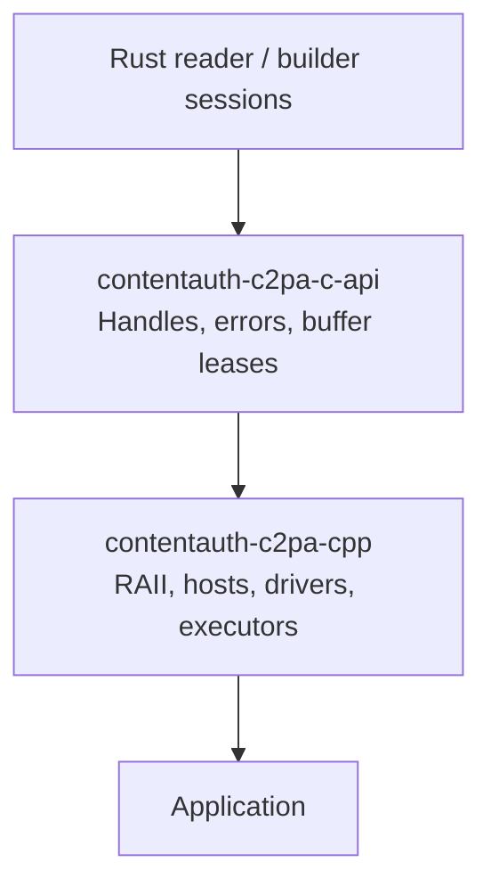

# Consolidating the C and C++ FFI boundaries

## Goal

Make [contentauth-c2pa-c-api](../contentauth-c2pa-c-api) the single owner
of the C ABI, and make [contentauth-c2pa-cpp](../contentauth-c2pa-cpp) a
C++ library consuming it.

Preserve the completed zero-copy work and existing C++ behavior. This is
a boundary consolidation, not an engine redesign. All I/O, networking,
and scheduling remain host-owned.

## Strategy

Ignore external consumers for this migration. Use the Rust FFI currently
inside the C++ project as the replacement implementation, moving its
ownership into the C API crate.

1. Establish complete behavioral coverage in the C++ FFI, including tests
   replicated from the existing C API and tests of the C++ FFI's own exports.
2. Replace the C API implementation with the proven C++ FFI.
3. Route C++ calls to the canonical C API crate.
4. Remove the duplicate FFI implementation from the C++ project.

## Phase 1: Establish complete test coverage in the C++ FFI

Compare both ABIs and define one contract covering:

- Session creation, advancement, request IDs, and fulfillment.
- Fresh requests versus outstanding requests.
- Errors, invalid arguments, panic containment, and busy handles.
- Finish/free behavior, including failed or incomplete sessions.
- Reader results: JSON, validation state, active label, and embedded status.
- Signing results: manifest bytes and exclusions.
- Read/write lease ownership and cancellation rules.

There are meaningful differences to resolve, not just different function
names. For example, the former C API returned JSON and a found flag from
read finish, while C++ exposed a richer reader object. The canonical
[reader ABI](../contentauth-c2pa-c-api/src/reading.rs) now uses the richer
result contract.

Replicate the existing C API's test scenarios and assertions against the
C++ project's Rust FFI while retaining the original tests. Adapt test
calls to the replacement API rather than preserving obsolete API shapes.
Document intentional error or ownership contract differences explicitly;
do not weaken behavioral assertions merely to make the port pass.

This phase is not limited to imported tests. Inventory every exported
function in the C++ Rust FFI, including APIs absent from the old C API,
and add tests for missing reachable behavior. Any new FFI introduced
during this work must include its tests in the same phase.

**Exit criterion:** Both implementations' suites pass. Every existing C API
scenario is covered against the replacement or has an explicitly justified
contract difference. Every C++ FFI export has meaningful coverage of its
supported behavior and reachable error/ownership paths, with allocation
identity and independent lease lifetime verified.

### Tests for this phase

- Map requirements and C++ FFI exports to existing tests, imported tests,
  and identified coverage gaps.
- Replicate C API read, build, cleanup/error, timestamp, OCSP, and roundtrip
  scenarios against the C++ Rust FFI.
- Add or extend tests for C++-specific/newer exports, including read-buffer
  acquisition/sealing/fulfillment, immutable write acquisition/release,
  typed reader accessors, and independently owned result handles.
- Cover null/malformed arguments, wrong-type/stale/busy handles, invalid
  IDs or replies, rejected ownership transfers, and cleanup.
- Verify large-buffer allocation identity, multiple immutable leases,
  out-of-order completions, acknowledgment, failure, and buffers/results
  surviving session destruction.
- Keep existing C++ driver cancellation and late-I/O tests passing.
- Measure coverage and add tests for uncovered reachable FFI paths; record
  any remaining untestable or platform-specific gaps.
- Run both Rust ABI suites and the relevant C++ tests before completing
  the phase. Do not stop when only the imported tests pass.

## Phase 2: Replace the C API implementation with the proven C++ FFI

Move/copy the proven Rust FFI from the C++ project into the C API crate,
along with its ABI tests. Replace the old implementation rather than
retaining two exported APIs. Preserve independently selectable read and
build features, updating in-repository callers as required.

The shared session bridge can remain the replacement's backend. Preserve
the tested lease mechanisms in the canonical boundary.

### Writable read leases

- Acquire initialized Rust-owned storage.
- Expose pointer and length to the host.
- Seal after I/O completes.
- Transfer the allocation into the session without copying.
- Preserve session/request identity checks and failed-transfer ownership.

### Immutable write leases

- Retain shared `Bytes` storage without copying payloads.
- Permit multiple immutable leases.
- Keep storage alive independently of acknowledgment or session destruction.
- Release explicitly after actual I/O completion.

The former C API copied read replies, so moving only declarations would
not suffice. The canonical
[signing implementation](../contentauth-c2pa-c-api/src/signing.rs) must
retain the replacement's allocation transfers, not reintroduce those copies.

Move the Rust lease tests alongside the canonical implementation, adding
coverage for its handle model and feature configurations.

**Exit criterion:** C API tests prove allocation identity, correct ownership
transitions, and safe storage after session destruction.

### Tests for this phase

- Migrate read/write lease tests from the C++ Rust ABI to the C API suite.
- Verify allocation identity across read fulfillment, forwarding, and write
  acquisition, including large source-copy operations.
- Cover duplicate acquisition rules, multiple immutable leases, wrong
  sessions/IDs, short reads, invalid handles, and rejected transfers.
- Verify that acknowledgment, failure, and session destruction do not
  invalidate independently owned storage.
- Keep existing copying-path tests and exercise supported feature builds.

### Result and error requirements

Provide the canonical accessors and owned handles C++ needs:

- Immutable reader/result handles that can outlive sessions.
- Typed validation state, without parsing JSON to recover it.
- Equivalent error information for C++ exceptions.
- Signing result views with explicit ownership.
- Consistent cleanup and rejected-operation behavior.

Preserve the replacement's existing result and error semantics wherever
they satisfy the agreed contract. Carry forward any missing capabilities
identified in Phase 1. Do not introduce another adapter layer merely to
reconcile the two implementations.

**Exit criterion:** The shared API can support both reading and signing
without private C++-specific Rust exports.

### Tests for this phase

- Add direct C ABI tests for typed validation state, reader metadata,
  signing result views, and equivalent error information.
- Verify result handles outlive sessions and have explicit cleanup rules.
- Test null outputs, wrong-type/stale/busy handles, premature finish, and
  ownership after rejected operations.
- Extend read-only/build-only tests for newly added exports.
- Preserve JSON, no-manifest, timestamp, and Trusted roundtrip assertions.

## Phase 3: Route C++ to the canonical API

Update the C++ wrappers to use the shared header and library:

- Session, reader, result, and error RAII.
- Read/write buffer RAII.
- Request conversion and reply fulfillment.
- Blocking, pooled, future, and coroutine drivers.

Update [CMakeLists.txt](../contentauth-c2pa-cpp/CMakeLists.txt) to build
and link the C API crate instead of the C++ Rust crate.

The public C++ surface should remain unchanged where practical,
especially the new read/write buffer interfaces. All I/O, networking,
and scheduling remain host-owned.

**Exit criterion:** The full C++ suite passes against the canonical C API,
with no dependency on the old Rust ABI.

### Tests for this phase

- Adapt C++ ABI-facing tests to the canonical API without weakening their
  behavioral or ownership assertions.
- Run blocking, pooled, future, and coroutine read/sign roundtrips.
- Verify pointer identity at the C++ host boundary and delayed read/write
  completion after cancellation.
- Run C++17 compile/link checks and a C compile/link smoke test against the
  generated canonical header and library.
- Run the C++ suites under ASan/TSan and the Linux POSIX fault-injection tests.

## Phase 4: Remove the duplicate boundary

Only after the switch is verified:

- Remove the C++ project's Rust ABI, Cargo manifest, and obsolete C
  headers/generator configuration.
- Retain C++ RAII wrappers around canonical C handles, along with the C++
  hosts, drivers, and executors; these are not duplicate Rust FFI code.
- Remove its Rust workspace membership.
- Move useful remaining ABI tests into the C API suite before deleting
  duplicates.
- Update build scripts, CI, coverage paths, and documentation.
- Retain the shared session bridge wherever other bindings still use it.

Then apply a functional C++ layout: public interfaces, binding
implementation, executors, tests/support, and examples.

Keep directory moves separate from the ABI migration where possible,
so failures and review diffs remain understandable.

**Exit criterion:** There is one C ABI implementation, C++ consumes it
directly, and no build or documentation references require the removed
Rust crate or duplicate headers.

### Tests for this phase

- Confirm every useful removed ABI test has a canonical replacement before
  deleting the original.
- Update test discovery, fixture/helper paths, coverage filters, and CI
  commands for the final directory and workspace layout.
- Build and test from a fresh build directory to catch dependencies on old
  libraries or headers.
- Run the complete C API and C++ suites, workspace checks, supported feature
  configurations, and generated-header verification.
- Inspect coverage for migrated behavior and add tests for reachable gaps;
  removing duplicate code must not remove unique test coverage.

## Validation gates

Before considering the migration complete:

- Preserve existing C API callers and read-only/build-only feature builds.
- Pass C++17 compatibility checks and all runtime tests/examples.
- Verify Trusted signing/read-back across the existing drivers.
- Prove zero-copy allocation identity, not merely equivalent output.
- Exercise late I/O, cancellation, failure, and session destruction under
  ASan/TSan.
- Run Linux-specific partial-I/O and interruption tests.
- Recheck coverage, generated headers, formatting, Clippy, and rustdoc.
- Run workspace checks because crate membership and linking change.

## Phase 1 coverage inventory

At the Phase 1 checkpoint (`b222b96`), the original C API tests remained
in place and the C++ Rust ABI tests exercised the replacement independently.
No production ABI, header, build routing, or workspace membership changed
in that phase. Phase 2 migrates the behavioral coverage to the canonical
crate rather than retaining the obsolete API's test drivers.

### Replicated reader and cleanup scenarios

The additional tests live in
[`tests/reader.rs`](../contentauth-c2pa-cpp/src/tests/reader.rs), alongside
the existing [`tests.rs`](../contentauth-c2pa-cpp/src/tests.rs) suite.

| Original C API scenario | Replacement coverage |
|---|---|
| Invalid settings/types/formats and malformed UTF-8 | Existing creation/null-argument tests plus `constructor_rejects_invalid_settings_types_and_non_utf8_settings` |
| Null sessions and unknown request IDs | `all_reply_variants_reject_null_sessions_and_unknown_ids` |
| Invalid advance outputs preserve the session | `invalid_advance_output_preserves_the_session` |
| Malformed payloads preserve requests; host failure is terminal | `invalid_payloads_preserve_requests_and_host_failure_is_terminal` |
| Empty byte reply validation | `empty_byte_payloads_are_accepted_then_fail_reading` characterizes the replacement's validation timing |
| Premature finish is terminal | `finish_consumes_incomplete_sessions_and_clears_reader_output` |
| Existing signed asset and manifest-free asset | Existing signed-asset and no-manifest end-to-end cases |
| Baseline build/read roundtrip metadata | `build_and_read_roundtrip_preserves_the_baseline_manifest_fields`: active label, one manifest, title, instance ID, claim version 2, both assertion labels and Trusted state |
| Authenticated good/revoked OCSP responses | `authenticated_ocsp_responses_distinguish_good_and_revoked_signers` |
| Malformed OCSP and unavailable responder | `ocsp_malformed_and_unavailable_transport_retain_the_manifest_report` |
| Owned string/error cleanup | `owned_reader_strings_outlive_the_reader_and_do_not_alias` and `owned_errors_outlive_the_session_and_success_clears_error_slots` |

The real OCSP tests reuse the existing C API's certificate/response
fixtures, sign through the public C++ project's signing ABI, and read
through its public reader ABI. No network requests are made. They check
request URL/DER and distinguish authenticated Trusted/not-revoked from
Invalid/revoked outcomes.

### Reader/common export inventory

All 18 reader/common exports have direct ABI test coverage. Names in this
table have the prefix `c2pa_sm_`.

| Exports | Coverage group |
|---|---|
| `version` | Static, terminated version string |
| `session_new` | Valid creation, missing/invalid format/settings, malformed UTF-8, JPEG-only format policy |
| `session_advance`, `session_request_count`, `session_request` | Fresh-only batches, invalid/null outputs, request field mapping, real OCSP |
| `session_fulfill` | Every reply variant, invalid/unknown/duplicate IDs, malformed/empty buffers, host failure and OCSP |
| `session_finish`, `session_free` | Signed, unsigned and malformed assets; premature/failed finish and terminal cleanup |
| `reader_json`, `reader_active_label`, `reader_is_embedded`, `reader_free` | Reader metadata, null handling, independent owned strings and cleanup |
| `reader_validation_state` | Typed Valid/Trusted/Invalid states and null Unavailable |
| `string_free` | Independent accessor allocations surviving reader destruction; null cleanup |
| `error_code`, `error_message`, `error_name`, `error_free` | Typed errors, null accessors, panic containment, owned error lifetime and clearing successful output slots |

### Replicated build scenarios

The additional tests live in
[`signing/tests/consolidation.rs`](../contentauth-c2pa-cpp/src/signing/tests/consolidation.rs),
alongside the existing
[`signing/tests.rs`](../contentauth-c2pa-cpp/src/signing/tests.rs) suite.

| Original C API scenario | Replacement coverage |
|---|---|
| Invalid constructor strings, unsupported format/algorithm, malformed definition, certificate pointer validation | Existing constructor matrix plus `c_api_constructor_scenarios_validate_each_string_with_valid_companion_fields` |
| Unknown IDs rejected by every fulfillment | `c_api_unknown_build_ids_are_rejected_for_every_reply_kind` |
| Invalid payload buffers preserve the outstanding request | `c_api_malformed_payload_matrix_preserves_the_pending_build_request` |
| Null session/output validation | Existing output matrix plus `all_build_session_exports_reject_null_and_wrong_type_handles_without_consuming_results` |
| Host failures are terminal; failed finish returns no allocations | Existing per-operation failure tests plus `c_api_failed_build_remains_terminal_and_finish_returns_no_report` |
| Timestamp request/response and granted token embedding | Existing long-form, refused, malformed, and empty response tests plus `c_api_short_form_timestamp_token_is_embedded_without_its_response_envelope` |
| Returned manifest is embedded; exclusion ranges are nonempty and in bounds | `c_api_returned_manifest_is_embedded_and_every_exclusion_is_nonempty_and_in_bounds` |
| Premature finish is terminal | Existing `finish_consumes_incomplete_sessions_and_rejects_stale_handles` and `failed_finish_with_null_output_consumes_the_session` |
| Successful signing and Trusted read-back | Existing `signing_abi_round_trips_a_jpeg_through_the_existing_reader_as_trusted` |

### Signing export inventory, including newer APIs

All 15 signing exports have direct ABI test coverage:

| Export | Coverage group |
|---|---|
| `c2pa_sm_build_session_new` | Constructor and format-policy matrices; roundtrips |
| `c2pa_sm_build_session_advance` | Fresh-only batches, waiting, completion, sticky failures, invalid outputs/handles |
| `c2pa_sm_build_session_request` | Field mapping, invalid indices/outputs, null/wrong-type sessions |
| `c2pa_sm_build_session_fulfill` | Every reply kind, unknown/duplicate IDs, malformed buffers, preserved requests, host failures |
| `c2pa_sm_build_session_finish` | Successful result ownership, premature/null-output finish, stale/busy handles |
| `c2pa_sm_build_session_free` | Cleanup, null no-op, stale/wrong-type/busy rejection |
| `c2pa_sm_sign_report_view` | Manifest/exclusion assertions, independent result lifetime, null/stale/wrong-type outputs |
| `c2pa_sm_sign_report_free` | Null no-op, busy/wrong-type rejection, double-free protection |
| `c2pa_sm_build_read_acquire` | Allocation identity, duplicate acquisition, invalid outputs/IDs/types, busy sessions, allocation overflow |
| `c2pa_sm_read_seal` | Exact count, short/long reads, ownership preservation, wrong-type/stale/busy handles |
| `c2pa_sm_build_fulfill_read` | Same-allocation transfer, wrong session/ID/type, busy completion, duplicate completion, failed/abandoned requests |
| `c2pa_sm_read_buffer_free` | Independent lifetime, abandonment, null slots, wrong-type/stale/busy preservation |
| `c2pa_sm_completed_read_free` | Independent lifetime, cleanup after cancellation, null slots, wrong-type/stale/busy preservation |
| `c2pa_sm_build_write_acquire` | Shared pointer identity, multiple leases, fresh-batch clearing, acknowledgment/failure, large source forwarding |
| `c2pa_sm_write_buffer_free` | Independent lifetime, null slots, wrong-type/stale/busy preservation, successful nulling |

The existing C++ driver tests also check move-only RAII, pointer identity
at the host boundary, reverse-order completion, and late read/write I/O
after cancellation. They complement, rather than replace, the direct
Rust ABI tests.

### Contract differences and replacement prerequisites

These differences describe the Phase 1 baseline, not the final canonical
contract. Their Phase 2 resolutions are recorded below.

- **Formats:** The C API resolves formats through a registry whose default
  features include JPEG and TIFF; it also normalizes `image/jpg`.
  At that checkpoint the C++ session bridge accepted only `image/jpeg`,
  `jpeg`, and `jpg`, case-insensitively. The
  `build_format_aliases_and_current_registry_gaps_are_explicit` test records
  this limitation. Preserve registry-backed formats and accepted aliases
  before completing Phase 2; silently dropping them is not consolidation.
- **Errors and cleanup:** The old API exposes tracked error strings and
  separate byte/exclusion allocations. The replacement uses typed owned
  errors and report handles. Port assertions about error ownership and
  content, not obsolete function signatures or status numbers.
- **Finish:** The replacement consumes a valid session on successful or
  failed finish, including a null result output. The old API can preserve
  a session when rejecting null output arguments. Tests assert the actual
  replacement lifetime contract rather than dereferencing consumed handles.
- **Empty input:** The old C API rejects zero-length payloads at the
  boundary. The replacement can marshal an empty byte view; a short read
  is then rejected by engine validation. The test
  `empty_copying_read_reply_is_accepted_then_rejected_by_engine_length_validation`
  makes that distinction explicit.
- **Certificates:** The old constructor rejects an empty certificate
  chain or empty certificate entry; the replacement permits constructing
  both. The test
  `empty_certificate_chain_and_entries_are_not_rejected_at_construction`
  records this without implying that construction validates a credential.
  Decide the canonical validation point in Phase 2, rather than hiding
  this difference in a weakened constructor test.
- **Reader/common handle validation:** Unlike the replacement's
  cimpl-tracked signing handles, its reader/common pointers are raw owning
  pointers. Tests do not manufacture stale, double-free, or wrong-type
  calls that violate their safety contract. Preserve the existing C API's
  tracked-handle protection when completing Phase 2; moving the raw
  pointer implementation unchanged would not provide equivalent validation.
- **Settings:** The replacement rejects empty/whitespace settings strings,
  while absent settings or `{}` work. The original reader constructor
  permits whitespace settings. Record the canonical policy explicitly
  during replacement.
- **Online OCSP:** The replacement's compatibility settings default to
  online checks being off. Tests explicitly enable `verify.ocsp_fetch`
  for transport scenarios and separately check default/disabled behavior.
- **Features:** The old C API independently selects read/build exports.
  Preserve those configurations when relocating the replacement; the
  current C++ Rust ABI is not yet a feature-compatible drop-in.

## Phase 1 results

Phase 1 added 25 Rust ABI tests (14 reader/common,
11 signing) supplement the existing lifetime and zero-copy tests.
The inventory covered all 33 replacement exports. Production code, headers,
workspace membership, dependencies, and CMake routing were unchanged.

| Validation | Result |
|---|---|
| Both Rust ABI suites | 103 tests passed |
| C++ project's Rust ABI, coverage run | 66 tests passed; 98.54% line coverage, 97.11% region coverage |
| Original C API, read-only feature configuration | 17 tests passed |
| Original C API, build-only feature configuration | 21 tests passed |
| Original C API, neither workflow enabled | 2 tests passed |
| Normal C++ CTest suite | 110 tests/examples passed |
| AddressSanitizer C++ CTest suite | 110 tests/examples passed |
| ThreadSanitizer C++ CTest suite | 110 tests/examples passed |
| C++ project's all-feature/all-target Clippy | Passed with warnings denied |
| Repository-pinned nightly formatting | Passed |

The remaining uncovered Rust sites are defensive paths for future
non-exhaustive request variants, allocation/tracking failures, and
ownership-transition cleanup. Tests do not manufacture invalid enum
values, allocation exhaustion, or unsupported concurrent ownership
transitions to reach those paths. The added tests improve behavioral
coverage even where existing tests already executed the same lines.

Validation was performed on macOS. Linux-only POSIX fault-injection
tests were not run. The C++ sanitizer configurations instrument C++,
not the linked Rust static library.

This established a characterized test baseline rather than drop-in parity.
The next phase resolves the format and tracked-handle gaps and makes the
remaining contract choices explicit.

## Phase 2 results

The canonical C API now owns the proven reader/signing vocabulary and
independent signing read/write leases, backed by the neutral session bridge.
The old exported API and its implementation have been replaced, not retained
behind an adapter.

| Surface | Canonical implementation |
|---|---|
| Shared constants, error/string ownership and panic containment | [`src/lib.rs`](../contentauth-c2pa-c-api/src/lib.rs) |
| Reader sessions and typed immutable results | [`src/reading.rs`](../contentauth-c2pa-c-api/src/reading.rs) |
| Signing sessions, leases and result views | [`src/signing.rs`](../contentauth-c2pa-c-api/src/signing.rs) |
| Shared ownership tests | [`src/common_tests.rs`](../contentauth-c2pa-c-api/src/common_tests.rs) |
| Reader/protocol/roundtrip tests | [`src/tests.rs`](../contentauth-c2pa-c-api/src/tests.rs) |
| Signing/lease tests | [`src/signing/tests.rs`](../contentauth-c2pa-c-api/src/signing/tests.rs) and its consolidation submodule |
| Export selection and generated-header smoke tests | [`tests/check-features.sh`](../contentauth-c2pa-c-api/tests/check-features.sh) |
| Generated C declarations | [`include/contentauth_c2pa_c_api.h`](../contentauth-c2pa-c-api/include/contentauth_c2pa_c_api.h) |

### Resolved prerequisites and contract choices

- **Formats:** both bridges now use `Registry::standard()` and `AnyFormat`,
  preserving JPEG, TIFF/BigTIFF/DNG, MIME/extension hints and `image/jpg`.
  This also broadens format selection for the existing C++ and alternative
  async JavaScript hosts; their format tests and documentation are updated.
  The C++ constructor test is now
  `build_format_aliases_select_registered_handlers`.
- **Ownership:** canonical reader sessions, results, errors and returned
  strings use cimpl tracking, as do signing sessions/results/leases.
  Null, stale, wrong-type and busy-handle behavior is covered without
  intentionally dereferencing invalid owning pointers.
- **Certificates:** the canonical constructor rejects empty certificate
  chains and empty entries, preserving the original C API's early validation.
  This does not claim certificate-chain cryptographic validation at construction.
- **Settings:** empty/whitespace reader settings are treated as absent.
  JSON values still undergo the backend's normal type/structure validation.
- **OCSP:** online fetching remains opt-in under the compatibility settings;
  authenticated transport tests enable it explicitly.
- **Results and replies:** the replacement's typed reader/signing results
  and explicit ownership are canonical. A valid finish consumes the session
  even when incomplete/failed; empty read payloads can cross the boundary
  before the engine rejects a short read. Neither behavior preserves the
  obsolete API's exact signatures or numeric error vocabulary.
- **Features:** `read` and `build` independently select exported workflows.
  The generated header declares both APIs consistently; disabled APIs are
  absent from the library. Either workflow enables the shared bridge backend;
  neither workflow compiles that backend through the C API dependency.

The canonical TIFF/DNG roundtrip test,
`reading::tests::roundtrip::tiff_and_dng_roundtrip_have_two_nonadjacent_exclusions`,
builds real TIFF bytes under both hints, asserts exactly two nonadjacent
exclusions, then reads back through the canonical ABI as Trusted and checks
the complete baseline manifest object. The migrated lease tests retain
allocation-identity and independent-lifetime assertions.

### Validation

| Validation | Result |
|---|---|
| Workspace, all features | 931 tests passed in 60 suites |
| Canonical C API, both/read-only/build-only/neither | 71 / 26 / 43 / 4 tests passed |
| Canonical Rust ABI coverage | 98.08% lines; 97% functions |
| Workflow export selection | Symbol presence/absence verified for all four feature configurations |
| Generated header | Identical across feature configurations; C11 and C++17 smoke checks passed |
| C++ normal / ASan / TSan | 110 tests/examples passed in each configuration |
| Node reader / signing addons | 27 / 26 tests passed |
| Wasm workspace checks | `wasm32-unknown-unknown` and `wasm32-wasip2` passed, excluding the two network-owning Rust compatibility crates |
| Standalone Wasm boundary | `wasm32-unknown-unknown` check passed |
| Workspace Clippy / rustdoc / pinned nightly formatting | Passed with warnings denied where applicable |

The [CI test job](../.github/workflows/ci.yml) now runs the header/export
smoke script and all three nondefault feature test configurations. The
existing workspace coverage run exercises the default-enabled workflows.
The workflow YAML parses successfully and its added commands pass locally;
Linux execution remains CI validation.

Remaining uncovered canonical Rust sites are allocation/tracking refusal,
poisoned-string-lock handling, future non-exhaustive request variants,
sealing rollback, and closing/mapping locations. Unsupported races, invalid
enum values and deliberate allocation exhaustion are not manufactured to
reach defensive paths. Coverage was measured with an isolated profile
directory to avoid mixed instrumentation.

Validation was performed on macOS. Linux-only POSIX fault-injection tests
were not run, and the C++ sanitizers do not instrument Rust.

C++ still links its original Rust library and uses its existing header.
No CMake rerouting, workspace removal, or duplicate-FFI deletion has been
performed in Phase 2: those are Phases 3 and 4.

## Phase 3 results

The C++ binding now builds and tests against the canonical C API with no
dependency on its former Rust ABI.

- [`CMakeLists.txt`](../contentauth-c2pa-cpp/CMakeLists.txt) builds
  `contentauth-c2pa-c-api` with cargo and links `libcontentauth_c2pa_c_api.a`;
  the `c2pa_sm` target's include path is the C API's `include/` directory.
  Nothing in CMake builds, links or includes `contentauth-c2pa-cpp`'s own
  Rust crate, `include/contentauth_c2pa_sm.h` or
  `include/contentauth_c2pa_sm_sign.h`.
- The four C++ sites that included those headers now include the generated
  `contentauth_c2pa_c_api.h`: `c2pa_sm.hpp`, `c2pa_sm_sign.hpp`, the C++17
  compile check and the C++17 test. No wrapper, driver, host, executor or
  test body needed to change, because the canonical ABI keeps the proven
  names, struct layouts and ownership rules. Public C++ APIs, including the
  read/write buffer interfaces, are unchanged.
- The CMake project now enables C. A new plain C11 program,
  [`cpp/tests/c_link_smoke.c`](../contentauth-c2pa-cpp/cpp/tests/c_link_smoke.c),
  runs as CTest `c_api.c_link_smoke`. It links only the canonical library,
  drives a read session by hand over an in-memory JPEG, and checks the
  no-manifest result, owned errors, `jpeg`/`image/jpg`/`tif`/`image/tiff`/`dng`
  selection and a rejected signing definition.
- [CI](../.github/workflows/ci.yml) needs no new steps: its Linux
  (coverage, ASan, TSan) and macOS jobs configure, build and run `ctest`,
  which now includes the smoke test. Its comment describing the job was
  updated.
- README and walkthrough pages describe the new relationship and mark the old
  Rust crate and headers as pending removal.

| Validation | Result |
|---|---|
| Fresh build directory, normal | Built; 111 tests/examples passed (110 existing + C smoke) |
| AddressSanitizer | 111 passed |
| ThreadSanitizer | 111 passed |
| Only the canonical static library built under the C++ build's cargo directory | Confirmed; no `libcontentauth_c2pa_cpp.a` produced |
| Generated header after the C++ build | Unmodified (no diff) |
| C++17 compile/link check | Built with `-Werror` and linked |

Not run locally: the Linux-only POSIX fault-injection tests
(`tests_sign_posix.cpp`) and the gcovr coverage report, because this machine
has no running Docker daemon or Linux toolchain; the CI Linux jobs run both.
The sanitizers instrument the C++ only, not the Rust library.

The old Rust ABI crate, its tests, its hand-written headers and its
`cbindgen.toml` remain in the tree, unused by the C++ build, until Phase 4
deletes them after confirming each useful test has a canonical replacement.

## Execution

Use phase-sized commits, each independently buildable. Start with Phase 1
only, establish complete replacement-FFI test coverage, then replace the
C API implementation before switching C++. Report each phase's results
before proceeding to the next.

Every phase includes its test additions, migrations, and updates in the
same change as the behavior or structure it covers. A phase is not complete
until its targeted tests pass and the results and any platform-specific
validation gaps are reported. Do not defer testing to the end of the
consolidation.

Phase 1 is committed as `b222b96` and Phase 2 as `62e1324`; Phase 3 routes
the C++ build to the canonical C API. This document continues to be the
execution plan for Phase 4. Deleting the duplicate Rust ABI has not occurred yet.
