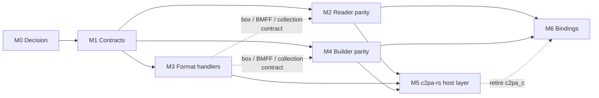
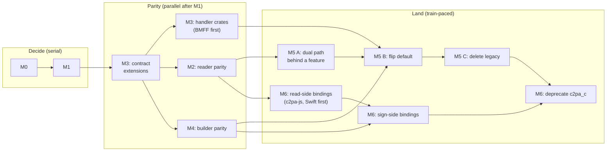

# Draft migration plan: adopting the sans-I/O core in c2pa-rs

_Status: draft for team discussion, 2026-10-21. Nothing here is committed
work. The milestones are sequenced by dependency, not by calendar; sizing
is relative (S/M/L/XL) and durations are deliberately left for the team to
fill in once ownership is settled. Where a question that changes the plan
is still open, the plan states the assumption it takes and marks it
**Assumption** so it can be revisited._

This document answers one question: if the c2pa-rs team adopts the
architecture prototyped in this repository as the core of the SDK, what are
the major milestones, in what order, and what proves each one done? It
assumes the reader knows both codebases; the
[walkthrough](walkthrough/README.md) is the tour of this one, and
[page 1](walkthrough/01-the-idea.md) is the structural comparison with
c2pa-rs.

## 1. Summary

The migration is a **strangler**, not a rewrite-and-switch. The sans-I/O
crates become the engine; c2pa-rs's `Reader`, `Builder`, `Context` and
`Settings` become a *host layer* over that engine, so the Rust public API
survives largely intact; the language bindings move, one at a time, from the
callback-driven C FFI to a host-driven C ABI; and the legacy store, claim,
crypto, HTTP and asset-handler code inside c2pa-rs is deleted only once
differential testing shows the two paths agree on real corpora.

Seven milestones, in dependency order:

| # | Milestone | Size | Proves |
|---|---|---|---|
| M0 | [Decision and governance](#m0-decision-and-governance) | S | The decision is recorded; homes, names, release model and CI obligations are settled. |
| M1 | [Freeze the contracts](#m1-freeze-the-contracts) | M | Everything bindings and hosts build against is stable enough to build against. |
| M2 | [Reader parity](#m2-reader-parity) | XL | The new validator reports what c2pa-rs reports, on every corpus we have, and passes the conformance suites. |
| M3 | [Format handlers as separate crates](#m3-format-handlers-as-separate-crates) | XL | Every supported container format has a handler crate outside the core, byte-compatible with c2pa-rs. |
| M4 | [Builder parity](#m4-builder-parity) | L | The new builder writes what c2pa-rs writes, and c2pa-rs reads it identically. |
| M5 | [c2pa-rs becomes a host layer](#m5-c2pa-rs-becomes-a-host-layer) | L | `c2pa`'s public API runs on the new engine; the legacy core is gone; the dependency budget is met. |
| M6 | [Bindings on the host-driven C ABI](#m6-bindings-on-the-host-driven-c-abi) | L | No binding spawns Rust threads or links a Rust async runtime for SDK work. |

M2, M3 and M4 run in parallel once M1 lands; M3's contract extensions are
on M2's and M4's critical paths (section 4). Three tracks run through every
milestone: differential testing, security, and the dependency budget
(section 5).

## 2. Why, in one paragraph each

**Asynchrony.** Every binding except the JavaScript ones goes through
`c2pa-c-ffi`, which is synchronous and callback-driven: streams are four C
callbacks, signers are a callback, HTTP resolvers and progress are
callbacks. c2pa-swift bridges its `async` signers to that with a
`DispatchSemaphore`, c2pa-android attaches threads in JNI, and
c2pa-js links the `c2pa` crate directly with a global tokio runtime under
Neon. Inside the SDK, 73 `#[async_generic]` sites and five paired trait
families (`Signer`/`AsyncSigner`, `SyncHttpResolver`/`AsyncHttpResolver`,
`PostValidator`/`AsyncPostValidator`, `DynamicAssertion`/`AsyncDynamicAssertion`,
`CredentialHolder`/`AsyncCredentialHolder`) keep two honest copies of every
path. c2pa-rs issue 1660 ("c2pa-rs shouldn't be in the threading business")
is the user-visible symptom. A session that never blocks and never spawns
dissolves all of it: the host chooses its own async idiom at the edge, and
the engine has one path.

**Dependency tree and format handling.** c2pa-rs's default build resolves
275 unique crates (348 with all features, 222 with none); the reader crate
here resolves 85, the engine 7, and the C API 102 (counts from `cargo tree`
on the same host, same method). Container knowledge leaks out of the
handlers into the core: `bmff_hash.rs` imports `bmff_io` internals,
`collection_hash.rs` imports `zip_io` internals, `box_hash.rs` takes a
handler's box map, and the signing pipeline in `store_io.rs` calls the
handler several times per save. Factoring asset I/O out therefore cannot be
only a crate split; it needs a contract that carries box maps, exclusions
and edit plans as *data*, which is what `contentauth-c2pa-format` is.

## 3. Where the two codebases stand

### 3.1 c2pa-rs today (main, `0.92.0-dev`, 2026-10-16)

| Area | Size (lines, `sdk/src`) | Notes |
|---|---|---|
| Public facade (`builder.rs`, `reader.rs`, `context.rs`, `manifest.rs`, `ingredient.rs`, …) | ~23k | `builder.rs` alone is 12.4k, of which ~8.5k is tests. |
| Store and claim internals (`store/`, `claim/`, `jumbf/`, `jumbf_io.rs`) | ~21k | `store_test.rs` and `claim_test.rs` are ~7.5k of it. |
| Assertions (`assertions/`) | ~14.5k | `bmff_hash` 3.7k, `box_hash` 1.9k, `actions` 1.4k, `ingredient` 1.3k. |
| Crypto (`crypto/`, `cose_sign.rs`, `cose_validator.rs`) | ~14k | Primitives already live outside, in `c2pa-raw-crypto`. |
| CAWG identity (`identity/`) | ~12k | X.509 and identity-claims-aggregation (W3C VC, `did:web`). |
| Asset handlers and I/O (`asset_handlers/`, `asset_io.rs`) | ~24k | 17 handlers; BMFF 4.0k, TIFF 3.6k, JPEG XL 2.6k. |
| Validation results, status tracker, settings, HTTP | ~10k | |
| **Total** | **~128k** | ~37.5k of it is inline tests. |

Policies that constrain the migration: a scheduled breaking train roughly
every two months (`0.x.0`), `main`/`stable` branching, deprecation on
`main` published by the next train and removed by the one after, and
support tiers whose merge gate (Tier 1A) includes `wasm32-unknown-unknown`
and `wasm32-wasip2`, with iOS, Android and Emscripten at Tier 2. All of
this is in `docs/` in c2pa-rs and is treated here as given.

### 3.2 This repository today (`origin/main`, 2026-10-20)

Roughly 55k lines of Rust across 18 workspace crates plus the JavaScript
package, two Neon addons, the C++ binding and the differential conformance
harness (pinned to c2pa-rs 0.91.3). What exists, by layer:

| Layer | Crates | Covers |
|---|---|---|
| Foundation | `state-machine`, `primitives` | `Session`, `SessionCore`, request tracking, protocol errors; shared `Bytes`, hash and signing algorithms, COSE `Sig_structure`, RFC 3161 encode/unwrap. |
| Workflows | `reader`, `builder` | Read: JUMBF, v1 and v2 claims, assertion hashes, `c2pa.hash.data`, claim signature, trust chains and profile, `sigTst`/`sigTst2`, OCSP (stapled, then online), CAWG `cawg.x509.cose`, `trust_list_uri`. Write: v2 claim, `c2pa.hash.data`, every C2PA signing algorithm, RFC 3161, CAWG X.509 identities via `SignPurpose`, caller-supplied assertions. |
| Formats | `format`, `format-jpeg`, `format-tiff`, `format-registry` | The `FormatHandler` contract (`locate`, `plan_embed`, `commit`, plain-data descriptors, `EmbedPlan` with a *list* of exclusions), two deliberately different handlers, content detection, type-erased `AnyFormat`, conformance kit. |
| Orchestration | `file-reader`, `file-builder` | Sessions that compose a handler with a reader or builder; blocking `Read + Seek` hosts; atomic file output. |
| Bindings | `rs-compat`, `rs-compat-sign`, `js-compat`, `js-compat-sign`, `session-bridge`, `wasm` + `js/`, Node addons, `c-api`, `cpp` | A c2pa-rs `Reader` slice, a c2pa-wasm `WasmReader` slice, the neutral read/build bridges, a shared JS Worker host over Wasm and Neon, a cimpl-backed C ABI over the file sessions, and C++17/20 drivers (blocking, pooled, coroutine) over a second C layer of their own. |
| Proof | `c2pa-rs-compat-conformance`, `docs/security` | Differential tests against the real `c2pa` crate in both directions, a corpus runner, and a running log of c2pa-rs security fixes triaged against this code. |

In flight on `origin` as of this writing, and already shaping the
milestones below: ingredients (#32), async-authored workflows (#46),
session debuggability and record/replay (#58), concurrent hashing and a
host-configurable hash window (#39), a Swift package on the C API (#33),
format detection in Rust (#54), engine fuzzing (#56), TIFF and JPEG
security-fix ports (#41, #43), zero-copy read leases for C++ (#65), and a
series of JavaScript host, ownership and benchmark PRs from Ale.

### 3.3 The gap, in one table

What c2pa-rs does today that this repository does not. This is the parity
backlog that M2, M3 and M4 consume; the appendices expand it.

| Area | Gap |
|---|---|
| Read: manifest graph | Ingredient recursion (depth limit, visited set, label-conflict resolution), update manifests, redaction checks (`assertion.notRedacted` and the v2 rules), remote manifest retrieval, sidecar lookup. |
| Read: hard bindings | `c2pa.hash.bmff` v1–v3 (Merkle per `mdat`, UUID proof boxes, init segment plus fragments), `c2pa.hash.boxes`, `c2pa.hash.collection.data`; `data_hash_exclusions_match_manifest`; update-manifest offset adjustment. |
| Read: identity | `cawg.identity_claims_aggregation` (EdDSA, `did:jwk`, `did:web`, issuer allow-list). |
| Read: results | The full status vocabulary (Appendix A.3), `ValidationResults` semantics (`activeManifest` vs `ingredientDeltas`, de-duplication against stored ingredient results, `validationTime`, `specVersion`), `detailed_json`, crJSON, `post_validate`, progress and cancellation. |
| Read: misc | Brotli-compressed stores, data boxes, `c2pa.time-stamp` and `c2pa.certificate-status` assertions, strict v1 validation, action rules, cloud-data and external-reference checks, soft-binding algorithm policy. |
| Write | Typed assertions (actions, thumbnails, metadata, Exif, CreativeWork, soft binding, …), intents and automatic actions, ingredients that carry manifests, parents and update manifests, redaction, archives (working stores), dynamic assertions with reserved sizes, OCSP stapling and `c2pa.certificate-status`, `c2pa.time-stamp` assertions, remote/sidecar/`no_embed` modes, BMFF/box/collection bindings, fragmented DASH, verify-after-sign, thumbnails, `claim_generator_info` defaults, the `ManifestDefinition` JSON schema. |
| Formats | 15 of 17 handlers: PNG, GIF, BMFF (MP4/MOV/M4A/HEIC/HEIF/AVIF), RIFF (WAV/AVI/WebP), SVG, JPEG XL, PDF, MP3, FLAC, ZIP family (EPUB/OOXML/ODF/OXPS), `.c2pa` sidecar, plain and structured text. XMP remote-reference read/write in all handlers. In-place patch and removal. |
| Host layer | The `Settings` schema, `Context` (resolvers, signers, progress, cancel), `Signer`/`AsyncSigner` and the factories, `Ingredient` and `Manifest` as public types, `jumbf_io`, `export_schema`. |
| Bindings | Full `Reader`/`Builder` surfaces for c2pa-js, c2pa-swift, c2pa-android, c2pa-python, c2pa-cpp; the 65-function `c2pa_c` ABI. |

## 4. Milestones

### M0. Decision and governance

**Goal.** Turn "mostly in favor" into a recorded decision with owners, so
the later milestones have somewhere to land and someone to land them.

**Scope.**

* An architecture decision record in c2pa-rs's `docs/`, pointing at this
  repository's walkthrough as the design and at this document as the plan.
* **Homes and names. Assumption:** the engine, workflow, format and
  binding crates stay in their own repository under the `contentauth`
  organization (this one, transferred), published to crates.io, with
  c2pa-rs depending on them exactly as it already depends on `c2pa-cbor`
  and `c2pa-raw-crypto`, including the cross-repo canary workflow. The
  `contentauth-` prefix stays until the crates are published, when the
  team chooses between `contentauth-` and `c2pa-`. The alternative,
  folding everything into the c2pa-rs workspace, is simpler for atomic
  changes but puts the heavy `c2pa` crate's Wasm, MSRV and `cargo-deny`
  gates in the same tree as crates designed to be light; the conformance
  harness here is kept out of the workspace for that reason today.
* **Release model.** The new crates adopt c2pa-rs's release-plz,
  Conventional Commits and train cadence, and its deprecation policy from
  their first published `0.x`. Until M1 they carry the "no compatibility
  guarantee" posture this repository has now.
* **CI obligations.** The new crates must meet c2pa-rs's Tier 1A targets
  from the first publish: `wasm32-unknown-unknown`, `wasm32-wasip2`,
  Windows ARM, MSRV. This repository already checks both Wasm targets and
  MSRV 1.96, which matches c2pa-rs; Windows ARM is new.
* **Security.** `SECURITY.md` and the advisory process extend to the new
  crates; the `docs/security` porting log becomes a standing step for
  every c2pa-rs security fix until M5 removes the duplicate code.
* **Policy for new format handlers during the transition.** Several
  handlers are open against c2pa-rs today (GLB, fonts, OGG, HTML, MIDI,
  ONNX, SafeTensors, Parquet). Decide whether new handlers are written
  against the `FormatHandler` contract from now on, so they are ported
  once rather than twice.
* Named owners for M1–M6.

**Exit criteria.** The decision record is merged in c2pa-rs; the crate
names are reserved; CI on this repository runs the Tier 1A matrix.

**Risks.** None technical. The cost of leaving this unsettled is that M2–M4
work lands in a place it later has to move from.

### M1. Freeze the contracts

**Goal.** Stabilize everything a host, a format handler, or a binding is
written against, so that the parity work in M2–M4 and the bindings in M6
do not churn each other. This is the one milestone where API design, not
feature work, is the point.

**Scope.**

1. **The `Session` contract.** `advance` / `outstanding_requests` /
   `fulfill` / `finish`, the `respond` helper for synchronous hosts, the
   not-re-entrant rule, and the diagnostics from #58: a `phase()` on every
   session, a failure that records phase and cause, and the `Recorder` /
   `replay` pair. Record/replay is what makes a bug report from a host in
   another language reproducible without that host.
2. **Request vocabularies and their conventions.** Per-direction failure
   semantics (reading is graceful per request, writing is fatal), the
   `SignPurpose` discriminator for signatures, and a general
   **`HttpFetch`-shaped request** for remote manifests, online OCSP, RFC
   3161 and `did:web`, with the *delegated-to-core* versus *host-specific*
   modes the original proposal described. Today the reader issues
   `Ocsp { url, request_der }` and the builder `Timestamp { digest }`; both
   are the host-specific mode, and the delegated mode is what lets a host
   be a dumb byte transport. The security policy for asset-supplied URLs
   (scheme allow-list, no credentials, no loopback, bounded response size,
   no redirects) is documented as a *host* obligation with a reference
   implementation, since the engine never opens the socket.
3. **Bulk payload ownership.** `Bytes` is already the shared refcounted
   payload type. Settle, and document per binding, who owns a borrowed view
   and for how long: the "valid until the next mutating call" rule in Rust,
   leases at the C ABI (#65), and transfer or copy at the JavaScript
   boundary (#72, #73, #76). This is the open FFI-lifetime question from
   the original proposal and it should be answered before M6, not during.
4. **Session checkpointing.** A parked session must serialize and resume
   with fresh request IDs and a versioned format. This is not optional: it
   is how c2pa-rs's archives / working stores (`to_archive` /
   `with_archive`) are expressed in this architecture (M4), and it
   constrains every intermediate data structure the parity work adds.
5. **The `FormatHandler` contract, version 2.** Extend `locate` /
   `plan_embed` / `commit` so that a handler can describe a **box map**
   (for `c2pa.hash.boxes`), **BMFF structure** (top-level box offsets, `mdat`
   ranges for Merkle hashing, fragment and init-segment relationships),
   **collection members** (ZIP entry ranges and the central directory),
   **XMP** remote-reference read and write, **in-place patch** of an
   existing store, and **removal**. Keep the rule that handlers describe
   and never read or write. Specify `DynFormatHandler` so a handler can be
   implemented in another language (the registry README's sketch).
6. **Workflow authoring style.** Decide whether sessions are written as
   hand-rolled phase enums (the reader today) or as the async-authored
   workflows of #46, which poll a future without a runtime. This decides
   how every M2 and M4 slice is written, so it is an M1 decision even
   though it is internal.
7. **The bridge wire shape, and one C ABI over it.** The flat
   `PendingRequest` / `Reply` data model in `session-bridge` is what Wasm,
   Neon and the C++ binding consume. It is *not* yet what the C API
   consumes: `contentauth-c2pa-c-api` wraps `FileReadSession` and
   `FileBuilderSession` directly and projects their requests into its own
   `C2paSmReadRequest` / `C2paSmBuildRequest` structs, while
   `contentauth-c2pa-cpp` exports a second `c2pa_sm_*` C layer over the
   bridge, so the repository has two C ABIs in one symbol namespace today
   (both export `c2pa_sm_string_free`). Before the bridge shape is frozen,
   move the C API onto the bridge and merge the two C layers into one ABI
   whose request structs are a mechanical projection of the bridge enums;
   that single ABI is what M6 ships. Then freeze the bridge shape, document
   it, and consider publishing it as a WIT world so the contract has a
   language-neutral statement.
8. **Settings and results as data.** The sessions' settings (`ReadSettings`,
   `BuilderSettings`, trust anchors, hash window) and reports stay plain
   data; the c2pa-rs `Settings` JSON/TOML schema is a *host-layer*
   concern that maps onto them (M5). Decide now which c2pa-rs settings
   have no engine counterpart and must be host behavior (thumbnails,
   `allowed_network_hosts`, backing-store thresholds).

**In flight here:** #46, #56, #58, #65, #72, #73, #76.

**Exit criteria.** Each item above is documented with a stability
statement; the engine, primitives, format contract and session-bridge
crates are published as `0.x` with the deprecation policy in force; there
is one C ABI, built on the bridge, and the C++ binding links it rather
than its own; the engine has fuzz and property tests (#56) in CI;
record/replay round-trips every existing test transcript.

**Risks.** Over-freezing: the parity work in M2–M4 will discover contract
gaps (TIFF turned one exclusion into a list; ingredients need a protocol
for additional streams). The mitigation is to freeze *conventions* and
*ownership rules* here and allow additive vocabulary changes through M4,
with a second, firmer freeze before M6's bindings ship.

### M2. Reader parity

**Goal.** The new validator reports what c2pa-rs reports on every asset we
can get, and passes the conformance suites. "Parity" is defined by the
differential harness, not by a feature list: a disagreement is a bug in one
side or the other until triaged.

**Scope, in suggested slice order (weakest dependency first, as the read
path was originally built):**

1. **Ingredients, parents, update manifests, redaction.** Stage 1 of #32
   lands ingredient assertion decoding and checks; this slice adds the
   recursion (`MAX_INGREDIENT_DEPTH`, visited set), the update-manifest
   chain walk to find the binding claim, the update-manifest action and
   parent rules, label-conflict resolution, the v2 redaction rules
   (`assertion.selfRedacted`, `assertion.action.redacted`,
   `assertion.hardBinding.redacted`) and `assertion.notRedacted`
   (zeroed boxes at redacted URIs). Needs the multi-stream protocol
   decision from M1 only if ingredient *assets* are hashed, which reading
   does not require.
2. **`ValidationResults` semantics and the status vocabulary.** The
   ingredient-URI scoping that produces `ingredientDeltas`, de-duplication
   against an ingredient's stored `validationResults`, the "historical
   expiry suppressed by attested `insideValidity`" rule, `validationTime`
   and `specVersion`, and `validation_state`'s exact tolerance list
   (`signingCredential.untrusted`, `cawg.x509.*`, `cawg.identity.*`).
   Appendix A.3 lists the codes; it also lists the ones c2pa-rs defines but
   never emits, which the team should decide to drop rather than copy.
3. **Remote manifests and sidecars.** The `HttpFetch` request from M1,
   `verify.remote_manifest_fetch` semantics, `manifest.inaccessible`,
   `with_manifest_data_and_stream` as the detached-manifest entry point,
   and the `<file>.c2pa` sidecar fallback as host-layer behavior.
4. **The other hard bindings.** `c2pa.hash.boxes`, `c2pa.hash.bmff` v1–v3
   including Merkle trees and fragment verification (whole file, init plus
   one fragment, init plus many), and `c2pa.hash.collection.data` for ZIP.
   Depends on M3's contract extension; the handler crates for BMFF and ZIP
   are the test vehicles.
5. **Identity claims aggregation.** COSE_Sign1 over a W3C VC, EdDSA,
   `did:jwk` and `did:web` (another `HttpFetch`), the `cawg.ica.*` codes
   and the issuer allow-list. Removes the only case where c2pa-rs's sync
   path is less capable than its async path.
6. **The long tail.** Brotli-compressed stores with the size cap, data
   boxes and credentials, `c2pa.time-stamp` and `c2pa.certificate-status`
   assertions (a timestamp assertion takes precedence over the header one),
   strict v1 validation, the action rules (`verify_actions`), cloud-data
   and external-reference checks, soft-binding algorithm policy, icon
   hashed-URI checks, the certificate-profile details not yet surfaced
   (RSA modulus minimum, named-curve allow-list, outer-equals-inner
   signature algorithm), `x5chain` in the unprotected header for old
   manifests, and the EKU configuration.
7. **Outputs and hooks.** `detailed_json`, crJSON (with its schema
   fixture), `resource_to_stream`, `post_validate`, and progress phases
   mapped onto session phases (M1 item 1) so a host can drive c2pa-rs's
   progress callback from `phase()` and cancel by dropping the session.

**Proof.** The corpus runner (`compare_corpus`) over c2pa-org
`public-testfiles`, every `make_test_images` golden, the c2pa-rs fixture
directory, and the adversarial fixtures; both validators run through the
C2PA validator conformance suite tracked in c2pa-rs issue 2824 (110 cases;
c2pa-rs `main` passes 62 today, all 110 with its open PRs) and the CAWG
suite tracked in 2884. Every disagreement is either a filed bug on one
side or a documented, intentional delta. The security porting log is
current.

**Exit criteria.** Zero untriaged disagreements on all corpora; conformance
suite pass count equal to or better than c2pa-rs at the same commit; crJSON
output validates against the schema; the reader crate still builds for
both Wasm targets and still resolves well under the dependency budget.

**Risks.** This is a from-scratch validator and c2pa-rs is a moving
target: in the time this plan was written c2pa-rs opened more than twenty
validation PRs for the conformance suite. Pinning the comparison to a train
(as the harness pins 0.91.3 today) and re-pinning once per train keeps the
target still enough to hit. The second risk is the status-code tail; the
mitigation is to treat the conformance suite, not c2pa-rs's current
behavior, as the authority wherever they differ.

### M3. Format handlers as separate crates

**Goal.** Every container format c2pa-rs supports has a handler crate
implementing the (extended) `FormatHandler` contract, byte-compatible with
c2pa-rs's output where c2pa-rs's output is the convention, and nothing in
the reader, builder or contract crate knows a format exists. This is the
asset-I/O factoring, done against a contract rather than as a crate split.

**Assumption:** this milestone is the landing place for the asset-I/O work
Gavin has been doing in c2pa-rs; the merged `HandlerRegistry` and
`Context::with_io_handler` work there is the in-core precursor, and the
2024 attempt to split `asset_handlers` into a `c2pa-codecs` crate (closed
for inactivity) is the cautionary tale: it tried to move the code before
the contract existed.

**Scope.**

1. **Contract extensions** (M1 item 5) land first, with the conformance
   kit extended to exercise them against an in-memory host.
2. **Handlers, in an order chosen for what each one teaches the contract**,
   as TIFF taught it exclusions:
   * **PNG** — chunk CRCs; the first real use of `commit` patches.
   * **BMFF** (MP4, MOV, M4A, HEIC, HEIF, AVIF) — box maps, Merkle `mdat`
     hashing, fragment and init-segment relationships, in-place patch; the
     largest handler (4.0k lines) and the one live video (C2PA 2.5) and
     fragmented DASH depend on.
   * **RIFF** (WAV, AVI, WebP) — rewrites a size field, which `Edit::Emit`
     anticipates.
   * **GIF**, **SVG**, **JPEG XL**, **MP3**, **FLAC** — breadth; each
     carries ported security fixes (the RIFF bomb, nested `moov`, ID3
     underflow fixtures in c2pa-rs are the regression corpus).
   * **ZIP family** (EPUB, OOXML, ODF, OXPS) — collection hashes and the
     central-directory placeholder; the OOXML relationship fix in flight
     on c2pa-rs belongs here.
   * **`.c2pa` sidecar** — the non-embedding shape.
   * **PDF** — `lopdf` today; the one handler whose dependency weight
     argues for a separate, optional crate from day one.
   * **Plain and structured text** — experimental in c2pa-rs; stay
     experimental, as separate crates.
3. **XMP** remote-reference reading and writing in every handler that
   supports it in c2pa-rs (the `WriteXmp` blanket impl there is the list).
4. **Registry features** so a host selects exactly the formats it ships,
   which is what gives the C API and the bindings a per-format dependency
   story c2pa-rs never had.
5. **Thumbnail generation is not a handler concern.** It needs an image
   decoder and lives in the Rust host layer (M5) behind c2pa-rs's existing
   `add_thumbnails` feature.

**Proof.** Each handler passes `test_util::conformance::run_all`; each is
differentially tested against c2pa-rs's handler on the same inputs in both
directions (sign here, read there; sign there, read here); each has a
security-porting page under `docs/security`; each is fuzzed. Where a
handler's embedding is byte-identical to c2pa-rs's (JPEG is today), the
test asserts it; where it is not and need not be (TIFF appends a trailing
IFD), the test asserts that c2pa-rs validates the result.

**Exit criteria.** Every format in c2pa-rs's `docs/supported-formats.md`
has a handler crate; `format-registry` with all features resolves the same
set; the c2pa-rs differential suite is green for every format; M2 and M4
have the box, BMFF and collection inputs they need.

**Risks.** BMFF is large and is where c2pa-rs is changing fastest (live
video, Merkle fixes, TFRA offsets). Port it early, from a pinned train,
and expect to re-port fixes. Fonts, GLB, OGG and the ML-model formats open
against c2pa-rs today should be written against the new contract (M0
policy) rather than ported.

### M4. Builder parity

**Goal.** The new builder writes everything c2pa-rs's `Builder` writes, and
c2pa-rs reads the result identically. The two-pass placeholder scheme, the
session already *is* c2pa-rs's embeddable API (placeholder, hash, sign,
patch) with the host owning the container; parity is about what goes in
the manifest, not how it gets into the file.

**Scope.**

1. **Typed assertions.** Today the builder takes opaque CBOR and, with
   #32, interprets `c2pa.actions.v2` only. Add first-class types for the
   assertions c2pa-rs constructs itself (actions with templates and
   software agents, thumbnails, `c2pa.metadata` and `cawg.metadata`, Exif,
   CreativeWork, asset types, soft binding, time-stamp, certificate
   status, embedded and cloud data, external reference), keeping the rule
   that the host supplies encoded bytes and the builder binds exactly those
   bytes.
2. **Intents and automatic actions.** `Create(DigitalSourceType)`, `Edit`,
   `Update`; auto `c2pa.created` / `c2pa.opened` / `c2pa.placed`; the
   action templates and `all_actions_included`; the inception-action
   position rule.
3. **Ingredients with manifests.** Stages 3+ of #32: an *intake session*
   reads an ingredient asset (its own read-only session, result as plain
   data), the builder copies the ingredient's store verbatim, re-labels on
   collision, captures validation results, and generates ingredient
   thumbnails where the host supplies them. This is the multi-stream
   protocol decision from M1 made concrete.
4. **Parents, update manifests, redaction.** `Update` intent as a commit
   over a parent store; `definition.redactions` applied while building.
5. **Archives as session checkpoints.** `to_archive` / `with_archive` /
   `write_ingredient_archive` become "checkpoint the builder session" and
   "resume it"; c2pa-rs's JUMBF `application/c2pa` working-store format
   with the `org.contentauth.archive.metadata` tag is the on-disk shape to
   stay compatible with. Reading the legacy ZIP archive layout is a
   candidate to drop (section 7).
6. **Dynamic assertions.** CAWG X.509 identities already use `SignPurpose`;
   generalize to host-provided assertions with reserved sizes and content
   computed from the partial claim, which is what c2pa-rs's
   `DynamicAssertion` does, and what identity-claims-aggregation *signing*
   would need if the team ever adds it (c2pa-rs cannot create ICA today).
7. **Revocation and time at signing.** OCSP stapling into `rVals`,
   `c2pa.certificate-status` assertions for selected manifests,
   `c2pa.time-stamp` assertions with the auto-timestamp settings, the
   `sigTst2` form for v2 claims, and the signing certificate's profile
   check before signing (today the host vouches for the chain; c2pa-rs
   checks it).
8. **Output modes.** `no_embed` (sidecar), remote URL (XMP reference only),
   embed-plus-remote; brotli-compressed stores with box hash; `prefer_box_hash`.
9. **The other bindings.** BMFF with Merkle trees and inserted UUID boxes,
   box hash, collection hash, and fragmented DASH signing, each over the
   M3 contract.
10. **Verify after sign** as a reader session run by the orchestrator, and
    the `ManifestDefinition` JSON schema so `export_schema` has something
    to export.

**Proof.** Every `make_test_images` recipe reproduced through the new
builder, with c2pa-rs reading the output to the same JSON as it reads its
own (modulo documented deltas such as label generation); both-direction
round trips for every binding type and every format; the sign-baseline
case extended into a sign-*matrix* that every binding in M6 is held to.

**Exit criteria.** The recipe corpus is green; c2pa-rs's `Builder` tests
that exercise manifest *content* (not I/O plumbing) pass when pointed at
the new builder through the M5 host layer; archives round-trip across a
process boundary.

**Risks.** Reservation sizing with more variable-length content (OCSP
staples, identity assertions, timestamps) makes the "placeholder never
changes length" invariant harder to hold; the original proposal's
size-query requests and renegotiation round are the designed remedy and
should be built here, not retrofitted. Thumbnails need an image decoder
and must stay on the host side to keep the engine Wasm-portable and light.

### M5. c2pa-rs becomes a host layer

**Goal.** The `c2pa` crate's public API (`Reader`, `Builder`, `Context`,
`Settings`, `Manifest`, `Ingredient`, `ValidationResults`, the `Signer`
family) is re-implemented as a host over the new engine; the legacy core is
deleted; the dependency budget is met.

**Assumption:** this is a strangler and the Rust public API is preserved
wherever Rust's ownership rules allow, exactly as `contentauth-c2pa-rs-compat`
does for its slice today. The alternative, a redesigned API shipped as
c2pa-rs 1.0, would collapse M5 and M6 into one cutover and lose the
per-train differential safety net; it is not recommended, but it is a
legitimate choice the team should make explicitly.

**Scope, in three stages that map onto release trains.**

* **Stage A: dual path behind a feature.** Add the new crates as
  dependencies of `c2pa` behind an `unstable_sans_io_core` feature. Route
  `Reader::with_stream` and friends to a session when the flag is on; keep
  the old path when it is off. Add a differential test job to c2pa-rs CI
  that runs the fixture corpus through both paths and diffs the JSON. This
  stage is where `rs-compat` grows from a `Reader` slice to the full
  surface: `Settings` (JSON and TOML, dotted-path access, validation) maps
  onto session settings; `Context` keeps resolvers, signers, progress and
  cancel as *host* concerns that drive the session loop; `Signer` and
  `AsyncSigner` become two thin drivers of the same `Sign` request rather
  than two code paths; `jumbf_io` is reimplemented over the format crates;
  `add_thumbnails` lives here.
* **Stage B: flip the default.** On a scheduled train, the new core
  becomes the default and the old one moves behind a `legacy_core`
  feature, with the deprecation notice the policy requires. Bindings that
  link `c2pa` directly (c2pa-js) pick up the change here, before M6 moves
  them to the bridge.
* **Stage C: delete.** On the following train, remove `store/`, `claim/`,
  `jumbf/`, `asset_handlers/`, `asset_io.rs`, `crypto/` (except what the
  host layer still needs for signer construction), `http/`, the
  `async_generic` plumbing and the `MaybeSend` shims. Retire the paired
  traits that no longer have a reason to exist, on the deprecation
  schedule.

**Proof.** The c2pa-rs test suite (Tier 1A, 1B and 2) green on the new
path; the differential job green; `cargo tree` on the default build at or
under the budget set in M0; the Wasm Tier 1A configuration no longer needs
`wasm-bindgen-futures`, `tokio` or a reqwest `fetch` backend for the core.

**Exit criteria.** Stage C shipped on a train; no `async_generic` in
`sdk/src`; no handler code in `sdk/src`; the budget met; the security
porting log retired because there is one implementation again.

**Risks.** The train cadence means Stage A to Stage C is at least three
trains (roughly six months) once Stage A is ready, and c2pa-rs keeps
shipping features on the old path meanwhile; every such feature is
parity work for M2–M4. A feature freeze on the legacy core from Stage A
onward is the obvious lever and should be an explicit M0 decision.

### M6. Bindings on the host-driven C ABI

**Goal.** Every binding drives sessions from its own runtime, with its own
async idiom at the edge and no Rust threads, runtimes or semaphores
underneath. The callback-stream `c2pa_c` ABI is deprecated once nothing
needs it.

**Scope.**

1. **The C ABI.** The single `c2pa_sm_*` ABI that M1 consolidates out of
   `contentauth-c2pa-c-api` and the C++ binding's C layer (cimpl-tracked
   handles, cbindgen header, independently selectable `read` and `build`
   features, built on the session bridge) is published from the same place
   as `c2pa-c-ffi` and shipped in the same release artifacts, side by side.
   It grows to the full read and build surfaces as M2 and M4 land; its
   payload ownership follows the M1 lease rules.
2. **Bindings, in the order of what each one gains:**
   * **c2pa-js** — the biggest structural win: the shared JavaScript host
     over Wasm (browser) and Neon (Node) already exists here; moving
     c2pa-js's `c2pa-wasm`, `c2pa-web` and `c2pa-node` packages onto the
     session bridge drops tokio from the Node addon, lets browser reads run
     on the main thread, and makes the signer a plain `Promise`. The
     c2pa-js compatibility facades (#63) and the parity reports (#64) are
     the migration tooling.
   * **c2pa-swift** — #33 proves zero Rust threads, QoS inheritance and a
     cooperative executor that is not starved; it closes c2pa-swift#30 and
     c2pa-rs#1660. Signing via CryptoKit or the Secure Enclave with no
     semaphore.
   * **c2pa-android** — the same shape over JNI; Kotlin coroutines drive the
     loop; no `AttachCurrentThread` from Rust because Rust never calls out.
   * **c2pa-python** — ctypes over the new header; `asyncio` at the edge for
     callers that want it, plain blocking for those that do not.
   * **c2pa-cpp** — the C++ binding here (blocking, pooled, future,
     coroutine drivers) is the replacement; its README already records the
     review of c2pa-cpp's API and each departure.
3. **Public-API continuity per binding.** Each binding keeps its existing
   public surface where it is already async (c2pa-js, the Swift and Kotlin
   `suspend`/`async` entry points) and keeps blocking entry points as thin
   drivers where callers expect them (Python, C++). New capabilities
   (cancellation by dropping, progress from `phase()`, concurrent requests)
   are additive.
4. **Deprecate `c2pa_c`.** Once every official binding has moved, the
   callback-stream ABI goes through the deprecation policy. Third-party
   consumers (c2c2pa, the WordPress plugin via Node) get the published
   grace period.

**Proof.** Each binding passes the sign matrix from M4 and the read corpus
from M2 through its own public API; the thread-count, QoS and executor
tests from #33 have equivalents in each; the boundary-cost benchmarks from
the JavaScript PRs are tracked per binding so the copy-per-request cost
stays measured.

**Exit criteria.** No official binding links tokio, rayon or spawns a
thread for SDK work; `c2pa_c` is deprecated on a train; the binding repos
pin the new crates.

**Risks.** The per-request boundary crossing is a real cost (a `Buffer`
copy per chunk in Node where c2pa-node crossed once per call); the
measurements so far say it is not the bottleneck, but each binding should
re-measure before switching. GC'd languages make "valid until the next
mutating call" easy to violate; the M1 ownership rules and a defensive
copying mode are the mitigation.

## 5. Cross-cutting tracks

**Differential testing is the gate for everything.** Every milestone's
exit criterion is a comparison against something independent: c2pa-rs at
a pinned train, OpenSSL for X.509 and RFC 3161, the C2PA and CAWG
conformance suites, and the `public-testfiles` corpus. The harness exists
(`c2pa-rs-compat-conformance`, `compare_corpus`); the work is pointing it
at every corpus and keeping the pin current once per train.

**Security.** The `docs/security` porting log continues until M5 Stage C.
Fuzzing covers the engine (#56), every parser (JUMBF, COSE, CMS, the TIFF
graph walk) and every handler. `cargo-deny` runs on every crate. Host-side
network policy for asset-supplied URLs is documented once and implemented
in every host.

**Dependency budget.** Set numeric targets in M0 and chart them per train.
Starting points: c2pa-rs default build 275 unique crates; here the engine
7, reader 85, builder 79, C API 102. The reader's count is dominated by
`c2pa-raw-crypto`'s rust-native backend (73 of the 85, mostly the
RustCrypto signature and key crates); the X.509, CMS and OCSP decoding
behind the `cert.rs` seam adds about a dozen. So the lever, if the budget
needs one, is `c2pa-raw-crypto`'s own footprint, which the team owns,
rather than the DER layer the original proposal considered replacing.

**Performance.** Benchmarks against c2pa-rs for large assets, on the read
and write paths and across the bindings. The concurrent-hashing results
(#39: 2.6× c2pa-rs on simulated slow storage, with a host-configurable
window) and the Node throughput numbers are the baseline; a regression
budget per binding is part of M6.

**Documentation.** The walkthrough is maintained with the code (its README
says how); this plan is updated at each milestone's exit; c2pa-rs's
`docs/` gains the migration guide the deprecation policy requires at M5
Stage B.

## 6. Sequencing and parallelism

M0 is short and blocks everything. M1 is a design milestone and should be
small in calendar time but is the one most worth getting right. After M1:

* **M2, M3 and M4 run in parallel**, with M3's contract extensions
  (M1 item 5) landing first because the box, BMFF and collection bindings
  in M2 and M4 need them. The BMFF handler is the long pole of M3 and
  should start first.
* **M5 Stage A can start as soon as M2 is far enough along to read the
  fixture corpus**, since the differential job in c2pa-rs CI is itself the
  parity tracker. Stages B and C wait for M2–M4 to complete and then take
  two further trains by policy.
* **M6 can start for the read side after M2** and for the sign side after
  M4; c2pa-js and Swift are the natural first movers because the host code
  for both exists here. Retiring `c2pa_c` waits for M5 Stage C and the
  last binding.

## 7. Open questions and the assumptions taken

| Question | Assumption taken here | What changes if the answer differs |
|---|---|---|
| Strangler, or a redesigned API as c2pa-rs 1.0? | Strangler; `c2pa`'s public API preserved. | M5 collapses into a single cutover and M6 can ship new binding APIs without continuity work; the per-train differential safety net is lost. |
| Where does the code live, and under what names? | Separate repository under `contentauth`, published crates, c2pa-rs depends on them; `contentauth-` prefix until publish. | A monorepo simplifies atomic changes across engine and host layer but couples the light crates to the heavy crate's CI gates. |
| What is the shape of the asset-I/O factoring in c2pa-rs? | It converges on the `FormatHandler` contract; the in-core `HandlerRegistry` is its precursor, not its destination. | If the factoring keeps `Read + Seek` streams inside handlers, M3 becomes a two-step port (extract, then convert) and the plain-data contract's other-language story is lost. |
| Capacity and horizon; does the train cadence continue uninterrupted? | Yes; durations are left blank; a feature freeze on the legacy core from M5 Stage A is recommended. | Without a freeze, M2–M4 chase a moving target indefinitely; with fewer people, M3 handlers are the natural place to accept community help, since each is an isolated crate with a conformance kit. |
| What can be dropped at cutover? | Candidates: reading the legacy ZIP archive layout; `c2pa.hash.multi-asset` (label only, never verified); the status codes c2pa-rs defines but never emits; the experimental text handlers as core-maintained crates; the sync-only limitation on ICA. PDF is kept but as an optional crate. | Each dropped item is one fewer parity slice; each kept one is a line in Appendix A or B. |
| Which authoring style for sessions (hand-rolled phases or #46's async-authored workflows)? | Decided in M1 before M2–M4 begin. | Deciding late means rewriting parity slices. |

Questions the original proposal left open and this plan assigns: FFI
lifetime conventions (M1 item 3), checkpoint format guarantees (M1 item 4),
multi-asset sessions (M4 item 3), fragmented and streaming formats (M3
BMFF), and the sign-flow ordering constraints for CAWG and timestamps
(settled by the builder today; M4 item 7 extends it).

## Appendix A. Reader parity checklist

Condensed from c2pa-rs `main` at 2026-10-16. Items the engine already
covers are marked ✅; the rest is M2 scope.

### A.1 Store and manifest graph

- [ ] Load order: embedded store via handler; else XMP `provenance` URL; fetch only with `fetch_remote_manifests` and `verify.remote_manifest_fetch`; failure → `manifest.inaccessible`.
- [ ] `<file>.c2pa` sidecar fallback (host layer).
- [ ] No active manifest → `claim.missing`; update-manifest chain walked to find the binding claim; none → `claim.hardBindings.missing`.
- [ ] `c2pa.time-stamp` assertions parsed and verified per referenced claim (no trust check for v1).
- [ ] `c2pa.certificate-status` assertions tied to each manifest's signing chain.
- [ ] Redacted URIs must be zeroed or absent → `assertion.notRedacted`.
- [ ] Ingredient recursion: depth limit 200, visited set; malformed cases; manifest-box hash vs. pre-1.3 whole-claim hash; redacted ingredient compares `claimSignature`; ingredient signature re-verified; `ingredient.unknownProvenance`; URI scoping for `ingredientDeltas`; label-conflict resolution.
- [ ] Brotli `brob` stores with `max_decompressed_manifest_size_in_mb`; data boxes; credentials; salts.
- [ ] `claim.multiple`, `claim.malformed`, `assertion.json.invalid`, `assertion.cbor.invalid`, unsupported newer claim version.

### A.2 Claim

- ✅ Signature box URI inside own manifest; v2 label format; v1/v2 decode; v2 required fields; self-redaction.
- [ ] Update-manifest rules (allowed actions, no thumbnails, one parent, no binding); `manifest.multipleParents` (in #32).
- [ ] Assertion list vs. store: `hashedURI.match/mismatch`, `missing`, `outsideManifest`, `undeclared`.
- [ ] `verify_actions`: inception position, created-only since 2.4, `digitalSourceType`, translated languages, ingredient and redaction references, related assertions, software-agent icons, watermark needs soft binding.
- [ ] v2 metadata and `claim_generator_info` checks; soft-binding algorithm policy; cloud-data; external-reference; icon hashed URIs.
- [ ] Hard bindings: exactly one except in update manifests; ✅ `c2pa.hash.data` (add `data_hash_exclusions_match_manifest`, `additionalExclusions`, update-manifest offsets); [ ] `c2pa.hash.bmff` v1–v3; [ ] `c2pa.hash.boxes`; [ ] `c2pa.hash.collection.data`.

### A.3 Signature, trust, revocation, identity

- ✅ COSE algorithms ES256/384/512, PS256/384/512, Ed25519; P1363 EC signatures; key/algorithm agreement; `x5chain` protected header.
- [ ] `x5chain` in the unprotected header (older manifests), but not both.
- ✅ `sigTst` and `sigTst2`; TSA EKU; timestamp trust forced off for v1; trusted timestamp rescues an expired signer.
- [ ] Timestamp from a `c2pa.time-stamp` assertion takes precedence.
- ✅ Chain building, anchors, allowed list, `trust_list_uri`; ✅ profile: CA constraints, key usage, EKU; [ ] outer-equals-inner algorithm, RSA modulus minimum, named-curve list, Ed25519 parameter absence, RSA-PSS parameter validity, no unique IDs, critical extensions.
- ✅ OCSP stapled then online, bound to the chain, evaluated at timestamp time; [ ] `c2pa.certificate-status` as a source; `certificate_status_should_override`.
- ✅ CAWG `cawg.x509.cose` with separate anchors and `cawg.x509.*` remapping; [ ] `cawg.identity_claims_aggregation`: EdDSA, `did:jwk`, `did:web`, `valid_from`/`valid_until`, issuer allow-list, the `cawg.ica.*` codes.

### A.4 Results

- [ ] `ValidationResults::from_store`: `activeManifest` vs `ingredientDeltas`; de-duplication against stored ingredient results; suppressed historical expiry; `validationTime`; `specVersion`; `trustListUri` and `timestampTrustListUri`.
- ✅ `validation_state` tolerance list; [ ] `ValidationFailureSummary`.
- [ ] Status vocabulary: the success, informational and failure sets in c2pa-rs `validation_results.rs` (about 110 codes). Defined-but-never-emitted codes to decide on: `assertion.accessible`, `assertion.inaccessible`, `manifest.unknownProvenance`, `manifest.unreferenced`, `algorithm.deprecated`, `timeOfSigning.insideValidity`, `claim.required.missing`, `claim.cbor.invalid`, `ingredient.hashedURI.mismatch`, `claimSignature.outsideValidity`, `manifest.timestamp.*`, `manifest.compressed.invalid`, `assertion.dataHash.malformed`, `assertion.metadata.disallowed`, `hashedURI.*`.
- [ ] `json`, `detailed_json`, crJSON (schema fixture), `_checked` variants; `resource_to_stream`; `post_validate`; `into_builder`; `remote_url`; `is_embedded`.
- [ ] Progress phases mapped to session phases; cancellation.
- [ ] Fragmented media entry points (`with_fragment`, `with_fragmented_files`).

## Appendix B. Builder parity checklist

### B.1 Definition and configuration

- [ ] `ManifestDefinition`: `claim_version`, `vendor`, `claim_generator_info[]` with settings and default fallback, `metadata`, `title`, `format`, `instance_id`, `thumbnail`, `ingredients[]`, `assertions[]` (`{label, data: Cbor|Json, kind, created}`), `redactions[]`, `label`, `hash_alg`; `remote_url`, `no_embed`, `timestamp_manifest_labels`. JSON schema export.
- [ ] Intents `Create(DigitalSourceType)` / `Edit` / `Update`.
- [ ] Builder settings: `vendor`, `claim_generator_info`, `intent`, thumbnail settings, action settings (auto created/opened/placed, templates, `all_actions_included`), `created_assertion_labels`, `prefer_box_hash`, `generate_c2pa_archive`, `auto_timestamp_assertion`, `bmff_hash_exclude_free_and_skip_boxes`, `ignore_ingredient_errors`, `certificate_status_fetch`, `certificate_status_should_override`.
- [ ] Signer settings: local and remote, C2PA and CAWG X.509, `referenced_assertions`, `roles`.

### B.2 Content

- [ ] Typed assertions: actions (v2, templates, software agent, region of interest), ingredient (v3), thumbnails (claim and ingredient), metadata and assertion metadata, Exif, CreativeWork, asset types, asset reference, embedded data, cloud data, external reference, soft binding, time-stamp, certificate status. Labels only: depthmap, IPTC, icon, multi-asset.
- [ ] Ingredients: from file, stream, `Reader`, archive; validated on add with results captured; thumbnails; `ignore_ingredient_errors`; merged with label-conflict resolution. (#32 covers manifest-less ingredients.)
- [ ] Parent and update manifests; redaction while building.
- [ ] Archives: JUMBF working-store format with the archive metadata tag; `write_ingredient_archive`; legacy ZIP read (drop candidate).
- [ ] Dynamic assertions with reserved sizes and `PartialClaim`-derived content. ✅ CAWG X.509 identities.

### B.3 Signing and output

- ✅ Every C2PA signing algorithm; RFC 3161 (`sigTst2`); two-pass placeholder with length invariance; exclusions as a list.
- [ ] `sigTst` for v1 claims (only if v1 writing is ever wanted; the spec forbids generators writing v1 today).
- [ ] `direct_cose_handling`; `reserve_size` and `cose_reserve_size`; signing-certificate profile check before signing.
- [ ] OCSP stapling into `rVals`; `c2pa.certificate-status` for selected manifests; `c2pa.time-stamp` assertions.
- [ ] Hard binding by format: BMFF (Merkle, UUID boxes, fixed leaf size), ZIP collection with central-directory placeholder, data hash, box hash when preferred or when compressing; brotli compression.
- [ ] Output modes: sidecar, remote-only, embed-plus-remote; sidecar only when no handler.
- [ ] Fragmented DASH signing.
- [ ] Verify after sign (and hash-only variant).
- [ ] Thumbnails via the `image` crate (host layer, `add_thumbnails`).

## Appendix C. Format handler inventory

c2pa-rs handlers, with the capabilities each implements there, as the port
list for M3. "Status here" is `origin/main` of this repository.

| Format(s) | c2pa-rs lines | Capabilities in c2pa-rs | Status here |
|---|---|---|---|
| JPEG | 1.5k | XMP, box hash, composed | ✅ `format-jpeg` (byte-compatible) |
| TIFF, DNG (writes tif/tiff/dng; reads arw/nef) | 3.6k | patch, XMP, composed | ✅ `format-tiff` (BigTIFF too) |
| PNG | 1.1k | XMP, box hash, composed | M3 |
| BMFF: MP4, MOV, M4A, HEIC, HEIF, AVIF | 4.0k | patch, composed, XMP, Merkle, fragments | M3 (long pole) |
| RIFF: WAV, AVI, WebP | 1.1k | patch, XMP | M3 |
| GIF | 1.6k | patch, XMP, composed, box hash | M3 |
| SVG | 1.4k | patch, XMP | M3 |
| JPEG XL | 2.6k | XMP, box hash, composed | M3 |
| PDF (`pdf` feature, `lopdf`) | 1.9k | composed, XMP | M3, optional crate |
| MP3 | 0.4k (+0.7k ID3 helper) | patch, XMP | M3 |
| FLAC | 0.4k | XMP, patch | M3 |
| ZIP family: EPUB, OOXML, ODF, OXPS | 0.6k | collection hash | M3 |
| `.c2pa` sidecar | 0.2k | box hash, composed | M3 |
| Plain text (A.8), structured text (A.9) | 0.6k + 0.9k | experimental | M3, experimental crates |

Handlers open against c2pa-rs and not yet merged (GLB, fonts, OGG, HTML,
MIDI, ONNX, SafeTensors, Parquet, Matroska, HEIF sequences) are covered by
the M0 policy decision.

## Appendix D. Binding inventory

| Binding | Links | How | Async today | M6 shape |
|---|---|---|---|---|
| c2pa-js (`c2pa-wasm`, `c2pa-web`, `c2pa-node`) | `c2pa` crate directly, `=0.91.3` | wasm-bindgen; Worker RPC; Neon with a global tokio runtime | Promises over `_async` SDK calls; `FileReaderSync` stream (Worker-only); signer via Neon `Channel` | Shared JS host over `contentauth-c2pa-wasm` and the Neon bridge; no tokio; main-thread reads; signer is a `Promise` |
| c2pa-swift | `c2pa-c-ffi` via `C2PAC.xcframework` | Swift package over the C header | Sync API; async signers bridged with `DispatchSemaphore` | #33: zero Rust threads, QoS inherited, `URLSession` for OCSP/TSA, CryptoKit / Secure Enclave signing |
| c2pa-android | `c2pa-c-ffi` release binaries | Kotlin + hand-written JNI shim | Sync; `AttachCurrentThread` in callbacks; a few `suspend` helpers | Coroutines drive the loop over the `c2pa_sm_*` header |
| c2pa-python | `c2pa-c-ffi` prebuilt, pinned `c2pa-v0.91.3` | ctypes, `CFUNCTYPE` callbacks | Sync with locks | ctypes over the new header; blocking driver plus an optional `asyncio` driver |
| c2pa-cpp | `c2pa-c-ffi` prebuilt or from source | C++17 wrapper | Sync | `contentauth-c2pa-cpp`: blocking, pooled, future and coroutine drivers |
| Rust consumers (c2patool, c2pa-attacks, c2pa-mcp, c2pa-min, c2pagen, conformance tool) | `c2pa` crate | — | Sync and async per crate | Unchanged public API through M5 |
| `c2pa-c-ffi` itself | — | 65 `extern "C"` functions; four-callback `C2paStream`; callback signer, HTTP resolver, progress | Fully sync; `tokio` declared but unused | Deprecated after every binding moves |

## Appendix E. c2pa-rs public types and where they go

| c2pa-rs type | In the host layer (M5) it becomes |
|---|---|
| `Reader` | A driver of `FileReadSession` over a `Read + Seek` stream (sync) or any async source (`_async`); holds the report, not a `Store`. |
| `Builder` | A driver of `FileBuilderSession`; `ManifestDefinition` maps to `BuilderSettings` plus typed assertions; archives are session checkpoints. |
| `Context` | Host state: settings, resolvers (the `HttpFetch` transport), signers (the `Sign` and `Timestamp` transports), progress callback (fed from `phase()`), cancel (stop advancing). Shared as `Arc` as today. |
| `Settings` | Parsed JSON/TOML mapped onto `ReadSettings` / `BuilderSettings` / trust configuration; host-only knobs (thumbnails, network allow-list, memory thresholds) applied by the host. |
| `Signer` / `AsyncSigner` | Two drivers of one `Sign` request; the trait surface is kept, the duplicated machinery behind it is not. |
| `Manifest`, `Ingredient`, `ValidationResults`, `ValidationStatus` | Public data types built from the session report; the JSON contract is preserved (as `rs-compat` does today). |
| `jumbf_io` | Reimplemented over the format crates and the registry. |
| `DynamicAssertion` | Host-provided assertion with a reserved size, answered through a request (M4 item 6). |
| `PostValidator` | A hook on the report after the session completes. |
| `asset_io`, `asset_handlers`, `store`, `claim`, `crypto`, `http` | Removed in M5 Stage C. |
