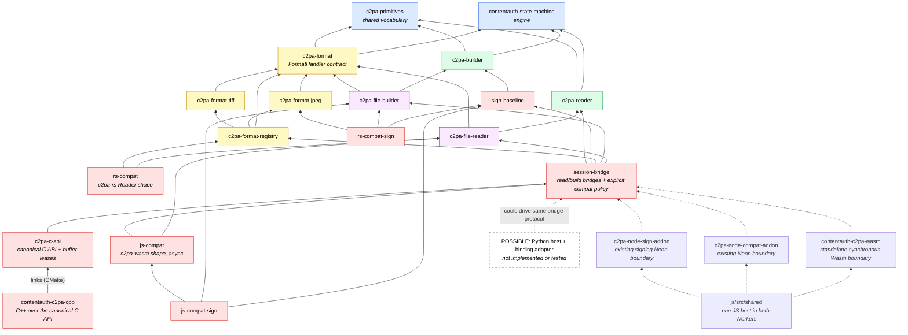
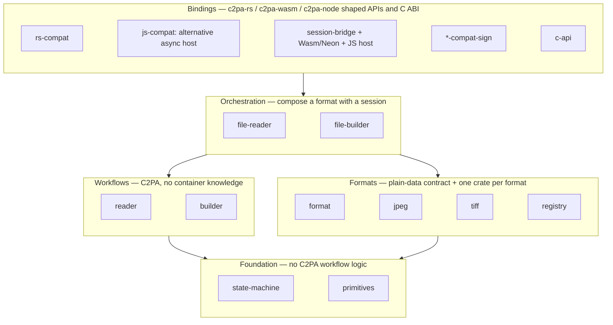

# 2. Architecture

About twenty crates sounds like a lot. They fall into layers, and the rule
that organizes them is: **each layer knows nothing about the ones above it,
and the reader, builder and format handlers know nothing about each other.**

## Dependency graph

Arrows point from a crate to what it depends on. Dashed edges include the
standalone Wasm and Neon bindings, plus the standalone JavaScript package.
The C++ reader/signing binding is a consumer of the canonical C API, which wraps the bridges. The outlined
Python node and its dotted edge indicate prospective reuse only.

(Edges to `primitives` and `state-machine` from most crates are omitted
where they would only add noise; every session crate depends on both.)
The C API's `read` and `build` features independently select its exported
workflows; either enables its shared session-bridge backend. Both are on
by default. The C++ binding is not a Cargo crate: it links the C API's static
library and generated header through CMake.

## Layers

## Crate table

The shared JS signing host transfers completed exact-length output buffers to
the caller rather than cloning payloads. This changes transport ownership, not
crate dependencies or the Uint8Array result type.

| Crate | Layer | What it is |
|---|---|---|
| `contentauth-state-machine` | Foundation | The engine: `Session`, `SessionCore`, request tracking, protocol errors, failure context (`phase()`, `Failure`), and `Recorder`/`replay` transcripts. Domain-agnostic. |
| `contentauth-c2pa-primitives` | Foundation | The narrow shared slice: `StreamId`, `ByteRange`, hash/signing algorithms, `HostError`, COSE `Sig_structure`, RFC 3161 encode/unwrap. |
| `contentauth-c2pa-reader` | Workflow | `ReadSession`: JUMBF, claims (v1+v2), integrity, signature, trust, timestamps, OCSP, CAWG identity assertions (X.509). |
| `contentauth-c2pa-builder` | Workflow | `BuilderSession`: v2 claim generation and signing via a two-pass placeholder scheme, plus optional CAWG identity assertions. |
| `contentauth-c2pa-format` | Format | `FormatHandler` trait, `FormatDescriptor`, `IoRequest`, `EmbedPlan`/`Patch`, test kit + conformance suite. |
| `…-format-jpeg` | Format | APP11 segments; byte-compatible with c2pa-rs. The template for other handlers. |
| `…-format-tiff` | Format | TIFF/BigTIFF/DNG; the format that forced `exclusions` to become a list. |
| `…-format-registry` | Format (host side) | Detect by content / extension / MIME; type-erased `AnyFormat`. |
| `…-file-reader` | Orchestration | `FileReadSession`: `locate` + `ReadSession`; plus a blocking `Read + Seek` host. |
| `…-file-builder` | Orchestration | `FileBuilderSession`: `plan_embed`/`commit` + `BuilderSession`, never buffering the asset; plus blocking hosts. |
| `…-rs-compat` | Binding | c2pa-rs `Context` + `Reader::with_file` slice; default `http` feature enables `reqwest` OCSP, otherwise uses the local-only file host. |
| `…-js-compat` | Alternative host | Earlier c2pa-wasm `WasmReader` slice; Rust async host with `Blob`/`Platform`, retaining its `web` exports and tests. Imports shared compatibility vocabulary from the neutral bridge. |
| `…-session-bridge` | Binding | `read::ReadSessionBridge`, `build::BuildSessionBridge` and explicit `compat` conversions; registry-backed JPEG/TIFF/DNG, no runtime, Wasm or Neon dependencies. Replaces both former Node-named Rust crates. |
| `…-sign-baseline` | Binding | The baseline signing case (JSON definition → `BuilderSettings`) every write binding is held to. |
| `…-rs/js-compat-sign` | Binding / alternative host | Blocking and Rust async baseline signing hosts retained. `rs-compat-sign`'s default `http` feature enables `reqwest` for RFC 3161; without it, the signer supplies the transport. |
| `c2pa-node-compat-addon`, `c2pa-node-sign-addon` | Binding | Separate Neon workspaces over the neutral read/build bridges. Existing JavaScript facades retain broader file/OCSP/timestamp behavior. |
| `…-c-api` | Binding | Canonical thread-free, callback-free C ABI over the neutral bridge (`c2pa_sm_*`); selectable `read`/`build` exports, cimpl-tracked handles, typed readers/signing results, independent zero-copy signing read/write leases and a generated header. |
| `c2pa-rs-compat-conformance` | Test | Separate workspace; differential tests against the real `c2pa` crate. |
| `contentauth-c2pa-wasm` + `js/` | Binding / preferred JS host | Standalone synchronous Wasm boundary and private JS package with shared host, browser and Node entry points. Offline JPEG read/baseline ES256 sign; caller-owned async callbacks. |
| `contentauth-c2pa-cpp` | Binding (C++, no Cargo crate) | C++17/20 reader and signing drivers over the canonical `contentauth-c2pa-c-api` C library and generated header (linked by CMake); blocking memory/stream/POSIX-file hosts, pooled/future/parallel drivers and C++20 coroutines, plus a plain-C link smoke test. A public-header ES256 signing example reads its output back as Trusted. Does not depend on the JS driver. |

The read/build bridges have been extracted and renamed, not copied. The
preferred JavaScript direction is the [shared host](../../js/README.md); the
older Rust async browser hosts remain alternatives until their useful behavior
is preserved by shared-host compatibility facades.

The merged [C++ binding](../../contentauth-c2pa-cpp/README.md) now consumes the
read/build bridges through the canonical C ABI, independently of the JS host. Python remains
prospective. The [read wrapper](../../contentauth-c2pa-session-bridge/src/read/mod.rs)
exposes numeric handles, byte vectors, strings and synchronous
`advance`/`fulfill`/`finish` methods; its
[crate dependencies](../../contentauth-c2pa-session-bridge/Cargo.toml) contain no
Neon or Node runtime dependency. The
[build wrapper](../../contentauth-c2pa-session-bridge/src/build/mod.rs) follows
the same host-driven pattern. The canonical C API is that C ABI adapter, and C++ consumes it;
Python could supply an extension-module adapter. Both must
translate Rust types/errors and define session and buffer ownership. The Rust
enums are not directly a stable foreign ABI, and neither consumer needs to use
the shared JavaScript driver or Workers. The current wrappers still reuse
JavaScript-oriented compatibility settings/results in Rust, now owned by the
explicit `compat` module. They are not generic engine requirements.

## Rules of the road

* **Reader and builder never mention a container format.** They ask for "the
  manifest store's bytes" or "embed this placeholder and report its range".
* **Formats never mention a session.** A handler speaks only `IoRequest`
  and returns plain data.
* **Only the registry names more than one format**, behind features.
* **Nothing is async below the host.** Even `js-compat`, the async one, has
  its `.await`s in a single function.
* **Lints enforce discipline:** `unsafe_code`, `missing_docs`,
  `unwrap_used`, `expect_used`, `panic` are denied at crate roots.

**Next:** [The read path →](03-read-path.md)
