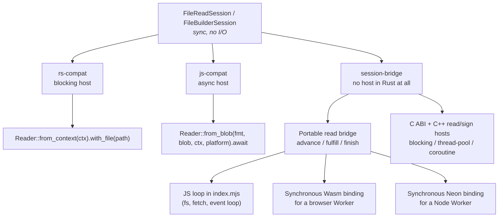
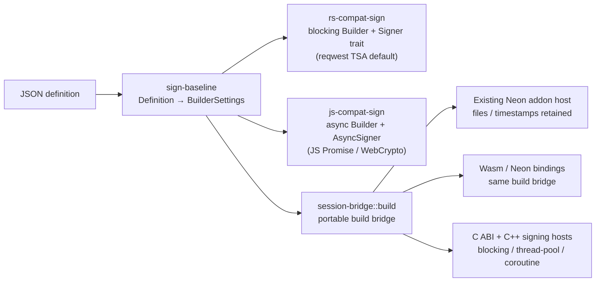

# 6. Bindings: one engine, three asynchrony models

Each compat crate reproduces a *slice* of a real public surface — same
method names, same error strings, same JSON — and differs only in **where
the asynchrony lives**.

The branches show host arrangements, not crate dependency arrows. Both
bindings expose the same neutral read bridge; neither uses the separate async
`js-compat` host.

| Binding | Mirrors | Async lives in | Notable |
|---|---|---|---|
| `rs-compat` | c2pa-rs `Context`, `Reader`, `Manifest` | Nowhere — blocking | One of two network dependencies (with `rs-compat-sign`): `reqwest` answers `Ocsp`. Owns format *policy* (`src/format.rs`). |
| `js-compat` | c2pa-wasm `WasmReader` | One `async fn` driving the session (`src/drive.rs`) | `Blob` ≈ `Blob.size` + `slice().arrayBuffer()`; `Platform` supplies clock/OCSP, which c2pa-rs gets implicitly. `web` feature adds a `#[wasm_bindgen]` `WasmReader`. |
| `session-bridge` + Wasm/Neon | Host-driven read/build, with explicit SDK compatibility policy | A JavaScript host in browser/Node Workers; the existing addon hosts also retained | Rust has no runtime, threads, locks or `async`. |
| `session-bridge` + `cpp` | Host-driven read/sign through a C ABI | C++ blocking, thread-pool or coroutine driver | Independent non-JS consumer of both bridges; supports atomic POSIX file signing. |

## Where the c2pa-rs shapes break down

The neutral [session-bridge crate](../../contentauth-c2pa-session-bridge/README.md)
now owns `ReadSessionBridge` and `BuildSessionBridge`, moved from the former
Node-named crates. Its explicit `compat` module owns settings, reports, format
selection and errors previously owned by `js-compat`; the latter reexports
those types and retains its original async behavior. Wasm and Neon import the
neutral bridge directly. The underlying engine/domain logic is not duplicated.
The bridge preserves the engine's shared `Bytes` for bulk writes and completed
build manifests rather than copying them into vectors. Wasm's binary write path
retains those shared buffers until the host consumes them; the final copy into
JavaScript-owned memory still belongs to the language boundary, not the engine.
The old addon JavaScript drivers remain intentional alternative hosts, not
silently replaced by the narrower Wasm/Neon bridges: they support file and
custom sources, OCSP, timestamp transport and transactional file output.
Retiring their loops or the Rust async hosts requires preservation tests for
those capabilities.
Platform adapters and transports are optional within the bindings. Both
Rust compatibility crates default to `http` (OCSP on the read side,
RFC 3161 on the signing side); `default-features = false` omits their HTTP
clients. The reader then uses the local-only file host and reports online
OCSP as unavailable, while the signer requires a transport override for
requested timestamps or fails explicitly. The JS read/sign crates already
select browser exports with the non-default `web` feature. Node's Rust
bindings have no built-in transport: the addon host owns filesystem and
network operations.

Honest differences, found by building these:

* **`Platform` is a new argument.** `fromBlob` has none; a sans-I/O engine
  must be *handed* the clock and OCSP transport explicitly.
* **OCSP defaults differ.** The engine defaults OCSP on; c2pa-rs's settings
  default it off, so `js-compat` maps the absent setting to off.
* **OCSP URLs are untrusted input** (they come from the asset's cert). The
  Node driver applies a policy (http(s) only, no credentials, no
  loopback/private literals), never follows redirects, and bounds the
  response at 1 MiB.
* **Reader state is a snapshot.** Node's `Reader` is parsed JSON, not a
  mutex-guarded live object.

## What the tests show

* `js-compat`: a `Blob` whose every read genuinely suspends, on a
  hand-rolled executor (no runtime dependency): completes correctly;
  yields once per request; **two reads interleave on one thread** — what a
  `FileReaderSync` stream can't do.
* Reader Neon addon: path / buffer / custom async source give identical
  JSON; timers fire throughout a slow read; eight reads interleave in well
  under serial time.
* Measured (256 MB, every byte hashed, release build): 510 MB/s at
  concurrency 1, 773 MB/s at 8, event-loop delay p99 ≈ 1.2–1.6 ms.

## The write side: the baseline signing case

`sign-baseline` fixes one scenario every binding must pass: JPEG +
c2pa-rs-shaped JSON (title, one generator, one `c2pa.actions.v2` /
`c2pa.created`) + ES256 → reads back `Trusted`.

* The signer is where the models diverge most: a blocking trait, an
  `async` trait that a browser backs with a non-extractable WebCrypto key
  that never enters Wasm memory, and a Node callback — the *normal* path,
  not a `CallbackSigner` special case.
* `instance_id` and `label` are required in the definition: the engine has
  no RNG, so the host mints them.
* An optional `tsa_url` opts into an RFC 3161 timestamp in the existing hosts.

**Next:** [Proof and CI →](07-proof-and-ci.md)
