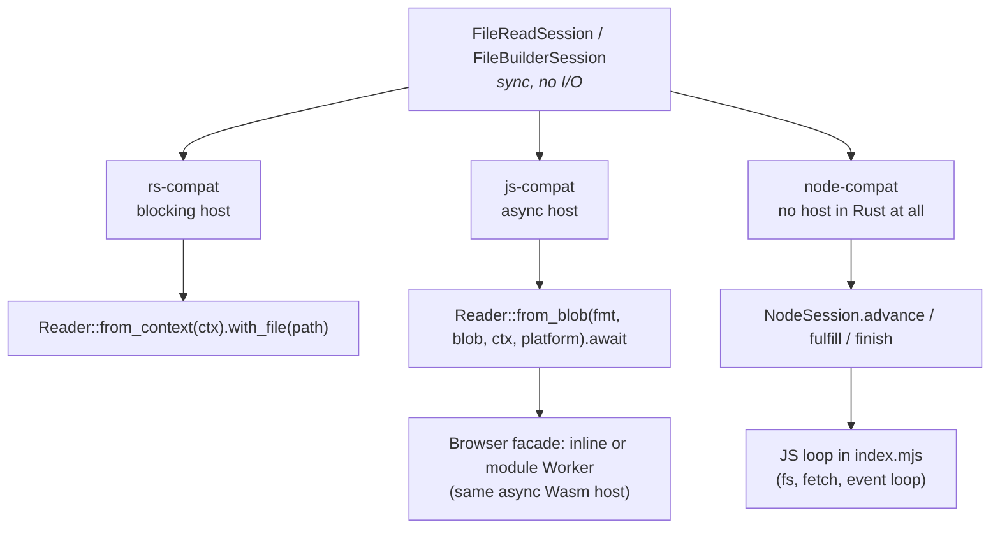
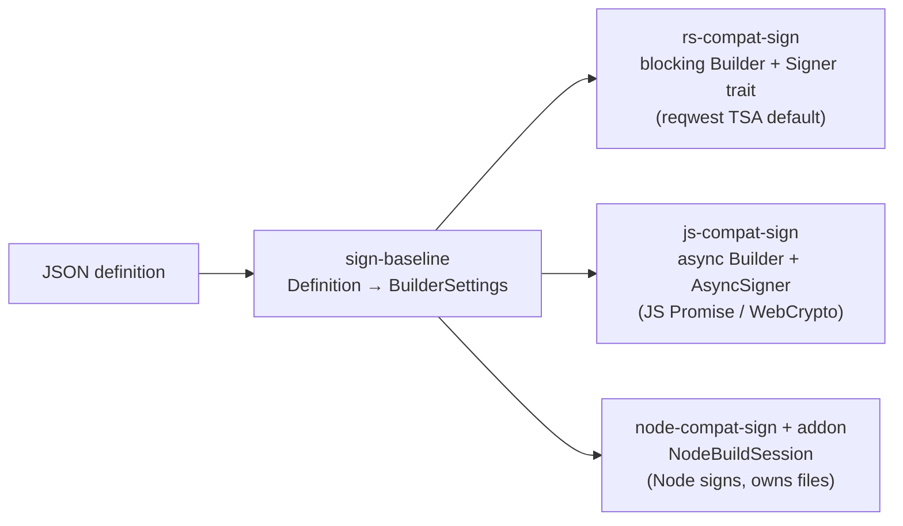

# 6. Bindings: one engine, three asynchrony models

Each compat crate reproduces a *slice* of a real public surface — same
method names, same error strings, same JSON — and differs only in **where
the asynchrony lives**.

| Binding | Mirrors | Async lives in | Notable |
|---|---|---|---|
| `rs-compat` | c2pa-rs `Context`, `Reader`, `Manifest` | Nowhere — blocking | One of two network dependencies (with `rs-compat-sign`): `reqwest` answers `Ocsp`. Owns format *policy* (`src/format.rs`). |
| `js-compat` | c2pa-wasm `WasmReader` | One `async fn` driving the session (`src/drive.rs`) | `Blob` ≈ `Blob.size` + `slice().arrayBuffer()`; `Platform` supplies clock/OCSP, which c2pa-rs gets implicitly. `web` feature adds a `#[wasm_bindgen]` `WasmReader`. |
| `node-compat` | c2pa-node `Reader` | Node itself | Rust has no runtime, threads, locks, or `async`. 4 synchronous exports (~150 lines of Neon). |

## Where the c2pa-rs shapes break down

Honest differences, found by building these:

* **`Platform` is a new argument.** `fromBlob` has none; a sans-I/O engine
  must be *handed* the clock and OCSP transport explicitly.
* **OCSP defaults differ.** The engine defaults OCSP on; c2pa-rs's settings
  default it off, so `js-compat` maps the absent setting to off.
* **OCSP URLs are untrusted input** (they come from the asset's cert). The
  Node driver applies a policy (http(s) only, no credentials, no
  loopback/private literals), never follows redirects, and bounds the
  response at 1 MiB.
* **Reader state is a snapshot.** Node's `Reader` is parsed JSON, not a
  mutex-guarded live object.

The browser's optional remote-manifest and OCSP callbacks keep network I/O
in JavaScript. The inline facade requires explicit origin authorization,
response bounds, deadlines, and optional abort signals. OCSP uses a DER POST
and remains off by default; inaccessible or unauthenticated responses are
reported without invalidating an otherwise trusted asset, while authenticated
revocation fails validation. Local signed-response tests cover both outcomes.

Browser and Node read/sign adapters now share the JPEG/TIFF registry selector.
The browser tests include classic TIFF and BigTIFF in both byte orders,
detached stores, nonadjacent exclusions, pixel tampering, and legacy validation
of classic TIFF output. DNG aliases are recognized; a camera corpus remains open.

The standalone JS prototype also offers explicit module-Worker hosting. Wasm
handles, asset reads/hashing, and bounded network hosts live in the Worker;
signing/timestamp callbacks remain on the caller thread. A readiness handshake
and URL/precompiled-module initialization precede operation messages. Free closes
resource proxies; runtime disposal terminates the Worker and rejects outstanding
operations. Abort signals cross as messages, without changing OCSP fail-open
policy. Three-browser tests cover read/sign, callback failures, cleanup, network
cancellation, and external-module CSP allow/deny behavior. Byte arrays are cloned
without detaching callers. The small-JPEG performance harness now compares both
Worker paths plus inline, with Worker-side read telemetry and separate
cross-thread command/reply counts. Each new Worker read uses one round trip;
its multiple Blob reads stay inside the Worker. Pure crossing cost and
large-asset memory still need measurement. There is no legacy fallback or
published package. A private compiled ESM/types/Wasm archive now installs into
an isolated external consumer without source aliases: TypeScript resolution and
a Vite production build pass inline/Worker URL/module loading, direct Worker
entry loading, sign/read cross-validation, detached output and cleanup in three
browsers. Runtime utilities are a declared dependency; test keys and harness
sources stay out of the archive. This is one private bundler proof, not registry
publication or full SDK compatibility.

Inline/Worker loaders now accept the implemented reader settings as factory
defaults, merged per read with the shared legacy helper. Static Reader Contexts
remain independent, as in legacy. Defaults are snapshotted per runtime rather
than retaining mutable caller configuration. Inherited OCSP flags still require
explicit operation-host authorization. Builder factories reject nonempty
defaults until builder settings exist; static builders do not inherit them.
Three-browser legacy comparisons and installed-consumer proof cover this slice.

The seventeen selected pinned upstream Reader tests now execute unchanged through
both inline and Worker in all three browsers. A separate 102-execution runtime
gate rejects missing/duplicate/skipped combinations and contradictory aggregate
outcomes. It proves unsigned, size-error, algorithm-error, free and serialization
behavior, exact embedded-thumbnail extraction and complete active-manifest
equality and trusted/untrusted complete-store goldens across the bridge, plus
omitted-format detection, explicit/independent/reused Contexts and deprecated
factory creation/merging. Unique upstream coverage is seventeen declarations
(17/249). Both paths resolve the original caller Context, preserving its
memoized Promise and cached policy rather than re-resolving raw settings in the
Worker. Construct a new Context for a changed policy. Concurrent legacy
comparisons and installed packages prove opposite trust settings stay isolated.
Resolution failures/disposal cannot dispatch late reads, and retries work.
Private Worker protocol v2 rejects stale v1 startup; ship client/Worker together.
The backend remains opt-in with explicit legacy selection as rollback.
Rust owns binary assertion
decoding and retention, and projects claim-thumbnail and generator-icon
references. Generator icons must resolve exact embedded assertions within their
owning manifest; relative and same-owner absolute references are supported.
Missing/ambiguous, cross-owner, external and deprecated databox targets fail
serialization explicitly. Real c2pa-rs v1/v2 fixtures prove both the boundary
and complete legacy v2 store/JSON equality, exact bytes, hash tampering and
recovery. Identical icon/assertion hash references are checked once; conflicting
digests/algorithms remain independently validated. Node shares icon reporting
and the same strict retained-resource lookup.
Ingredient thumbnails reuse the same exact-owner resolver, with native v1/v2/v3
reference/shape checks and genuine c2pa-rs v2 fixture comparisons against legacy.
Two positional resources match complete trusted reports and exact independent
bytes on both runtimes and installed packages; tampering remains invalid and
the second resource is unchanged. Deprecated v1 databox thumbnails fail
explicitly with release/retry proof.
Ingredient `data` now shares the same resolver, including exact positional
references and thumbnail/data coexistence. Real c2pa-rs v2 fixtures match
complete trusted legacy object/JSON reports and exact independent bytes; one
tampered payload retains failures without changing unrelated data/thumbnail
bytes. Native v1/v2/v3 boundary tests, installed extraction, Node metadata and
explicit databox rejection/retry are proven. Linked histories/redactions and
full ingredient validation remain separate; extracted data is not parsed or
trusted. Ingredient manifest-link/hash/history validation remains future core
work; the JS compatibility projection still rejects linked-history reports.
The binding experiment wraps available capabilities rather than implementing
those domain rules. Wasm and both
JS readers expose `resourceToBytes` with an absolute self JUMBF URI, returning
independent byte copies without new asset reads or network requests. Unknown or
ambiguous IDs fail explicitly; validation results, not extraction, determine
trust. Extra browser tests cover copy ownership, lookup recovery and lifecycle
errors; installed-package paths also verify extraction and signer metadata.
Rust preserves generator extensions and verified claim/CAWG X.509 signer
metadata, including unsigned decimal serials and authenticated timestamp times.
The compatibility `issuer` field is the signer's subject organization.
Unanchored times never establish trusted time; identity `revocation_status: true`
is legacy's verified-credential field, not OCSP proof. Internal hard-binding
and resource assertions remain in the core report, but not the compatibility
assertion list. Active-manifest projection is identical across object reporting
methods. Single-manifest trusted/untrusted full stores now match legacy:
top-level statuses contain failures only, while result buckets retain all
observations in stable legacy phase order. Assertion URLs identify their owning
manifest; named claim and timestamp trust-list provenance is scoped separately
from CAWG identity trust. Identity distrust does not change engine store state,
and tampering failures remain visible alongside unrelated successes.
The disabled-trust upstream golden also passes. `verifyTrust: false` changes
the core claim anchor policy, not integrity validation. CAWG `verifyTrustList:
false` instead omits identity anchors through the pinned utilities: identity
distrust still appears, and caps an otherwise trusted compatibility report at
`Valid` without changing the engine's claim state. Complete object/JSON
comparisons cover every independent option combination on both runtimes.
Factory false defaults, per-read re-enabling, installed-package behavior and
native expiry/profile/path-signature/binding preservation have regression proof.
Resource-free v1/v2/v3 ingredients now project into `ingredients` with positional
labels and version-specific metadata, rather than generic assertions.
Owner-qualified unknown-provenance observations appear as `ingredientDeltas`
for `parentOf`/`componentOf` inputs without source manifests; `inputTo` is
exempt. Full object/JSON legacy comparisons use a newly signed four-ingredient
asset. Tampering still exposes the live hashed-URI mismatch. Installed packages
and real Node addons use the shared Rust projection.
Ingredient assertion metadata now includes creation time, review ratings and
custom extensions. Complete legacy comparisons cover all three ingredient
versions, optional null/empty fields and JSON numeric-array formatting.
Ratings stay signed opinions, never validation or trust findings; tampering with
a review still fails the live assertion hash. Creation time is untrusted text.
Linked-manifest references, unsupported resource targets,
structured metadata references and historical validation
payloads remain unported and fail compatibility serialization explicitly,
rather than appear validated or disappear silently. Malformed supported fields
and unsupported numeric versions also error. These extra differential cases do
not raise the frozen upstream count. Full ingredient-link/hash validation,
historical-delta comparison and ingredient-building APIs remain future work.
Parsed legacy JSON now also matches for these fixtures on both runtimes.
The shared Rust JS/Node formatter base64-encodes nonempty all-number arrays in
object fields, including non-hash fields, without mutating object projections.
The pinned legacy display quirk discards negative/floating-point entries and
uses unsigned integers' low byte; empty/mixed/direct nested arrays are preserved.
Newly signed custom assertions verify the behavior against legacy; installed
package paths check base64 JSON versus byte-array object hashes.
Rust JSON methods are fallible and bindings propagate serialization errors
instead of returning an empty report. Whitespace/key-order byte equality is not
claimed. Linked-ingredient/history delta reports,
broader resource references, external resources, `crJson` and fragmented reads
still need implementation.

Local Worker RFC 3161 proof now covers authentic per-request RSA/SHA-256 tokens:
timestamped embedded output cross-validates as `Trusted` with
`timeStamp.validated` through Worker, inline and the pinned legacy SDK. Detached
Worker/inline output, concurrent callback routing, definition URL precedence and
explicit failure/retry paths are tested in three browsers. A wrong-imprint token
cannot supply trusted time and is reported informationally; current signer trust
still uses the host clock. Timestamp HTTP remains a caller-owned callback, not
a new production transport. Public TSA and algorithm breadth remain open.

A fourth, test-only Worker path caches small header reads in one operation-local
4 KiB read-ahead window, bypassing large reads. It reduces physical Blob reads
from 10 to 1 unsigned and 15 to 4 signed while preserving logical requests,
complete signed/tampered reports and malformed-input failures. It fetches extra
bytes, so this is an experimental trade-off, not an enabled production policy
or a change to Rust hash chunk sizes.

## What the tests show

* `js-compat`: a `Blob` whose every read genuinely suspends, on a
  hand-rolled executor (no runtime dependency): completes correctly;
  yields once per request; **two reads interleave on one thread** — what a
  `FileReaderSync` stream can't do.
* `node-compat` addon: path / buffer / custom async source give identical
  JSON; timers fire throughout a slow read; eight reads interleave in well
  under serial time. `resourceToAsset` now copies retained claim/generator/
  ingredient resources to independent buffers or asynchronous JS-owned files,
  with legacy `{buffer, bytes_written}` results. The native reader remains
  private until garbage collection; source closure, exact bytes, file
  truncation, tamper isolation and explicit failures/retry are tested. Large
  resource copies still run synchronously, not as a streaming API.
  `fromManifestDataAndAsset` now supplies a snapshotted sidecar to that same
  sans-I/O file session. Genuine c2pa-rs store-free/resource fixtures match the
  complete Trusted report golden; native tests match the async browser host.
  Explicit bytes set `isEmbedded` false and retain resource extraction, with
  tamper checks, no-fallback precedence, concurrent isolation and retry proof.
  JS still owns all source/clock/network operations.
* Measured (256 MB, every byte hashed, release build): 510 MB/s at
  concurrency 1, 773 MB/s at 8, event-loop delay p99 ≈ 1.2–1.6 ms.

## The write side: the baseline signing case

`sign-baseline` fixes one scenario every binding must pass: JPEG +
c2pa-rs-shaped JSON (title, one generator, one `c2pa.actions.v2` /
`c2pa.created`) + ES256 → reads back `Trusted`.

* The signer is where the models diverge most: a blocking trait, an
  `async` trait that a browser backs with a non-extractable WebCrypto key
  that never enters Wasm memory, and a Node callback — the *normal* path,
  not a `CallbackSigner` special case.
* `instance_id` and `label` are required in the definition: the engine has
  no RNG, so the host mints them.
* An optional `tsa_url` opts into an RFC 3161 timestamp; each binding
  leaves only the HTTP `POST` to its host.

**Next:** [Proof and CI →](07-proof-and-ci.md)
