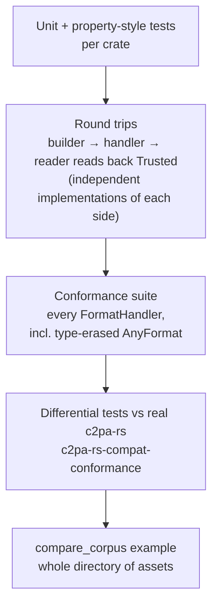
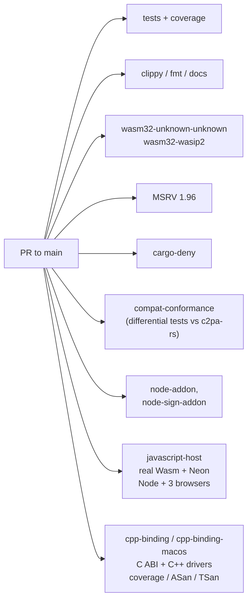

# 7. Proof and CI

A from-scratch reader/validator is only worth anything if it agrees with
the implementations people already trust. The evidence comes in layers.

* **Round trip.** The builder's primary correctness proof is that
  `contentauth-c2pa-reader` — written independently — reads what it
  builds as `Trusted`. Tamper tests flip image bytes or the rewritten TIFF
  pointer and expect failure.
* **Conformance kit.** `test_util::conformance::run_all` is what a new
  format handler must pass.
* **Differential testing against c2pa-rs.** A separate workspace (so the
  heavy `c2pa` crate doesn't burden this one's Wasm/MSRV/`cargo-deny`
  checks): the same client code reads a file through c2pa-rs and through
  `rs-compat` and compares. Both directions for TIFF — c2pa-rs-signed read
  here, and signed here read by c2pa-rs. This is what exposed the
  exclusions bug.
* **Corpus runner.** `compare_corpus` walks a directory (e.g. a checkout of
  c2pa-org's `public-testfiles`) and reports every disagreement. It has not
  yet been pointed at a large corpus — see [future](09-future.md).

## CI

`.github/workflows/ci.yml`, as separate jobs: unit tests + Codecov, doc
tests, Clippy (`-Dwarnings`), nightly rustfmt, rustdoc (warnings denied),
Wasm checks, MSRV (1.96.0), `cargo-deny`; plus separate jobs for the
`c2pa-rs-compat-conformance` differential tests (`compat-conformance`, run
on every PR) and the two Neon addons (`node-addon`, `node-sign-addon`).
The `javascript-host` job builds the standalone synchronous Wasm binding and
both Neon addons, then runs the shared Node and Chromium/Firefox/WebKit read and
signing contracts. It requires real bindings and installed browsers: no skips
or mock-only substitute. The SDK-to-SDK benchmark is a local command requiring
an existing sibling SDK build, not a dependency of PR CI.
The C++ binding jobs exercise the Rust C ABI plus C++17, C++20 and pool
drivers on Linux and macOS. The Linux matrix covers C++ coverage, AddressSanitizer
and ThreadSanitizer; macOS also exercises the Apple thread pool.

The Wasm checks are a design assertion: **the engine and everything over it
builds for Wasm unmodified**. Exempt: `rs-compat` and `rs-compat-sign`,
which deliberately own the workspace's only network dependencies. The `web`
modules of the alternative Rust async hosts are only *compiled*, not run.
Browser CI runs the preferred synchronous Wasm bridge with its JavaScript host,
not those older `web` modules. Its standalone locked Wasm workspace also has
native request-encoding tests, Clippy and formatting checks, but those checks
do not run in a browser. The SDK-to-SDK benchmark is a local command requiring
an existing sibling SDK build, not a dependency of PR CI.

**Next:** [Findings →](08-findings.md)
