# 9. Future directions

Everything below is drawn from the "not covered yet" sections of the crate
READMEs; none of it is committed work. Grouped by what it would teach us.

## Where we are

```mermaid
flowchart LR
    subgraph done["Done"]
        direction TB
        d1["Read + validate: integrity, signature,<br/>trust, RFC 3161, OCSP, v1+v2 claims"]
        d2["Write: v2 claim, data hash, any signing alg,<br/>timestamp"]
        d3["Formats: JPEG, TIFF/BigTIFF/DNG, registry"]
        d4["Bindings: rs / wasm / node, read and sign"]
        d5["Differential tests vs c2pa-rs"]
        d6["JS migration M0: pinned contract<br/>and legacy Chromium oracle"]
        d7["JS migration M1: real inline Wasm<br/>JPEG read/sign, three browsers"]
        d8["Initial JS read-boundary comparison:<br/>counts, bytes, timing, delayed host"]
        d9["M3 slice: JPEG XMP remote discovery<br/>opt-in bounded browser host transport"]
        d10["M3 slices: bounded browser OCSP<br/>TIFF/BigTIFF browser read/sign"]
        d11["M3 slice: explicit module Worker<br/>callbacks, cleanup, network, CSP proof"]
        d12["M3 feature slices: resources / reports / trust<br/>ingredient metadata / Context parity, 17/249 upstream"]
    end
    subgraph next["Next"]
        direction TB
        n1["Validation depth"]
        n2["More formats"]
        n3["Write-side breadth"]
        n4["Bindings and hosts"]
        n5["Proof at scale"]
    end
    done --> next
```

## 1. Validation depth (reader)

| Item | Why it matters |
|---|---|
| **Ingredients / parent manifests** | Metadata/reviews, same-owner embedded thumbnails/data and unknown-provenance deltas are projected. Ingredient manifest-link/hash validation, schema/signature rules, redactions, secure historical-delta comparison, linked-history/resource reporting and structured metadata remain core/projection dependencies, not binding feasibility tasks. Ingredient-asset validation may need new host requests. |
| **Redaction checks** (`assertion.notRedacted`) | Depends on ingredients. |
| **Remote manifest breadth** | JPEG standard XMP discovery and opt-in bounded browser fetching (including CORS/retry proof) are implemented; extended XMP and other format pointers remain open. |
| **CRLs** | Outside the spec §15.9 OCSP-only process the engine follows, but real certs use them. |
| **Other hard bindings** (box hash, BMFF) | Only `c2pa.hash.data` is validated. |
| **Broader resource projection** | Embedded binary assertions, claim-thumbnail references and browser `resourceToBytes` are implemented. Generator icons, ingredient-resource references, external resources and `crJson` parity remain open. |

## 2. More container formats

The template is established: a crate + the conformance suite, nothing else
changes. Choose formats for *what they exercise*, as TIFF did:

* **PNG** — chunks with CRCs, the first real use of `commit` patches.
* **BMFF (HEIC/AVIF/MP4)** — box-hash binding; fragmented BMFF is also
  what `fromBlobFragment` needs (two `Blob`s).
* **RIFF (WAV/WebP/AVI)** — rewrites an existing size field, which `Edit::Emit`
  already anticipates.
* **PDF, sidecar/`.c2pa`, and others** — non-embedding or very different
  shapes.
* **Extended XMP and TIFF remote-reference parsing**; JPEG standard XMP is done.
* **Formats in other languages** — the registry README sketches
  `DynFormatHandler` over a Wasm component, a JS generator, or a C ABI.
  The open parts are marshalling `EmbedPlan` safely and a conformance
  corpus that is *data*, loadable from any language.

## 3. Write-side breadth

* **Ingredients and update manifests** (the builder's biggest gap;
  `redacted_assertions` has no use without them).
* **Policy for already-signed assets**: `plan_embed` always replaces;
  whether to carry the old store forward as a parent is the caller's call —
  currently nobody makes it.
* **An orchestrator** that can juggle more than source and output streams
  (ingredient assets) — what the file-builder/file-reader READMEs point to.
* **Box-hash / BMFF bindings, certificate decoding/validation** on the
  write side (today the host vouches for the chain).
* **Generator `icon`**, richer assertion helpers.

## 4. Bindings and hosts

See the [JS migration implementation and proof plan](../js-migration-plan.md)
for the staged browser/Node parity work and compatibility-shim rollout.

* **`Builder` surface parity** for the c2pa-rs shape beyond the baseline
  case; `from_stream` and other constructors.
* **c2pa-node:** full Context/settings/size-limit parity, databox/external resources, signers,
  CAWG identity assertions (the X.509 type is done on the core read and
  write paths; this is the bindings), Trustmark.
* **Browser:** linked-ingredient/history delta reports and resources,
  broader settings/resources, full upstream Worker parity,
  classic-Worker/full-settings compatibility, registry publication and broader
  bundler compatibility. Private ESM/types/Wasm packaging now passes an isolated
  installed-consumer TypeScript/Vite production proof in three browsers, with
  inline/Worker URL/module loading, signing, cross-read and detached output.
  Reader-factory loader defaults now match legacy deep merging and static
  Context isolation, with runtime snapshots and explicit OCSP host gating;
  full settings and builder inheritance remain open.
  M1 runs the real read/sign adapters inline in three browsers;
  seventeen unchanged upstream cases now pass through both inline and Worker in
  three browsers (102 executions), with 232 declarations still unported.
  Omitted-format detection, explicit/independent/reused Contexts and deprecated
  factory creation/merging now pass. Worker reads preserve caller-side Context
  memoization; concurrent trust policies remain isolated and stale private v1
  Workers reject startup under protocol v2.
  Feature coverage includes exact embedded-thumbnail and generator-icon
  extraction, active-manifest
  equality, trusted/untrusted complete-store and blob-creation goldens, with extra
  ownership/lifecycle, failure-preservation and installed-package report checks.
  Real c2pa-rs-signed generator icons now match complete legacy reports and exact
  bytes; cross-manifest/external/databox icons still fail explicitly. Identical
  icon/assertion hash checks no longer duplicate observations; conflicting
  hashes remain checked. This adds migration proof, not frozen upstream passes.
  Same-manifest embedded ingredient thumbnails now reuse that resolver, including
  positional labels, complete legacy object/JSON equality and exact bytes from
  real c2pa-rs fixtures. Native v1/v2/v3 boundaries, live tamper failures,
  databox rejection/retry, installed extraction and Node metadata are proven.
  Same-owner ingredient data resources now also match complete legacy reports
  and exact independent bytes, including two positional resources alongside a
  thumbnail. Tamper isolation, v1 databox rejection/retry, native boundaries,
  installed extraction and Node metadata are proven. Linked histories/redactions,
  full ingredient-link/hash validation and databoxes remain open.
  Node now also extracts these resources through `resourceToAsset` buffer/file
  destinations. Native and browser readers share one strict absolute-URI lookup;
  private native payloads survive source closure until garbage collection, and
  asynchronous file I/O remains JS-owned. Actual-Node tests cover exact bytes,
  legacy result shapes, truncation, copy/tamper isolation and failures/retry.
  This is bounded Node resource support, not full API or streaming parity.
  Node now accepts explicit sidecars through `fromManifestDataAndAsset`, using
  the existing detached file session and reporting `isEmbedded` false. Genuine
  c2pa-rs store-free fixtures match complete Trusted reports and resource bytes;
  native browser-host comparison, binding tampering, snapshot/concurrent
  isolation, no-fallback precedence and error recovery are proven. These are
  adapted Node tests, not extra unchanged upstream declarations.
  Parsed legacy JSON now matches the trusted/untrusted fixture; signed custom
  assertions verify numeric-array/base64 display quirks without changing object
  views. `crJson` and whitespace/key-order byte equality remain unproven.
  Disabled claim-trust verification and independent CAWG anchor switches now
  match legacy full reports, with signature/integrity checks preserved.
  Resource-free v1/v2/v3 ingredient metadata and owner-qualified
  unknown-provenance deltas now match full object/JSON legacy reports for
  newly signed inputs; inputTo is exempt and live tamper failures stay visible.
  Linked/resource/history fields still fail compatibility reporting explicitly;
  these additional differential cases do not increase the 17/249 count.
  M3 adds opt-in bounded remote/OCSP JavaScript hosts, real local signed OCSP
  proof, and browser TIFF/BigTIFF read/sign in both byte orders. Real responder
  and DNG corpus breadth remains open. An explicit module-Worker entry now hosts
  those adapters off the main thread, with caller-thread signing callbacks,
  cancellation/cleanup, and external-module CSP proof. Local RFC 3161 Worker
  signing now proves per-request RSA/SHA-256 tokens, concurrent callbacks,
  inline/legacy validation, detached output and failure/retry behavior.
  Public TSA/algorithm breadth, expired-signer longevity and large-asset
  measurements remain open.
* **Other host languages** — Python, Swift, Kotlin, .NET: the Node binding
  shows the minimal shape (a handful of synchronous functions plus a host
  loop). Each is a good test of whether the flattened `PendingRequest`/
  `Reply` data model is the right wire format.
* **A WIT / Wasm component** exposing `advance`/`fulfill`/`finish` as the
  language-neutral form of the contract.
* **General cancellation and progress** — c2pa-rs's `Context` has them; browser
  network abort and Worker disposal are tested here, but a general session/
  Context cancellation or progress API is still open.

## 5. Proof at scale

* **Run `compare_corpus` against `public-testfiles`** and triage the
  disagreements. This is the highest-value next step for deciding whether
  the validator is trustworthy.
* **Track c2pa-rs releases** — the compat layer follows a moving target.
* **Fuzzing** the parsers (JUMBF, COSE, TIFF graph walks) — they already
  refuse hostile input by design, but nothing yet hammers that.
* **Large-asset and isolated boundary benchmarks.** The JS migration harness
  now compares unsigned and trusted signed JPEG reads against the pinned legacy
  SDK in Chromium, Firefox, and WebKit. It asserts read counts and bytes and
  records warmed timing distributions and delayed-host runs for legacy Worker,
  new inline and new module Worker. Legacy reads the Blob once; both new paths
  use multiple asynchronous range reads. Separate Worker message counts prove
  the new path makes one caller-to-Worker round trip, not one per Blob read.
  Natural timing rankings vary by browser; delayed-host latency still amplifies.
  A fourth test-only 4 KiB read-ahead Worker reduces physical reads while fetching
  extra bytes and preserving logical requests and validation. A broader corpus,
  cache-policy choices and memory evidence are needed before production adoption.
  This is initial evidence, not isolated crossing
  cost, large-asset memory proof, or a production performance budget. See the
  [experiment commands and caveats](../../c2pa-js-state-machine/README.md#host-boundary-performance-experiment).

## Questions for discussion

1. Is "host drives" worth the boundary cost for the bindings we ship?
   Which binding benefits most?
2. Should this stay a compat layer, or inform a change in how c2pa-rs
   itself exposes its I/O?
3. Which of the above would *change the architecture* if tackled (we think:
   ingredients, remote manifests) versus merely extend it (formats)?
4. Is the `Session` contract the right granularity, or should a coarser
   "run to completion with this host trait" API sit on top for most users?
