# 9. Future directions

Everything below is drawn from the "not covered yet" sections of the crate
READMEs; none of it is committed work. Grouped by what it would teach us.

## Where we are

```mermaid
flowchart LR
    subgraph done["Done"]
        direction TB
        d1["Read + validate: integrity, signature,<br/>trust, RFC 3161, OCSP, v1+v2 claims"]
        d2["Write: v2 claim, data hash, any signing alg,<br/>timestamp"]
        d3["Formats: JPEG, TIFF/BigTIFF/DNG, registry"]
        d4["Bindings: rs / wasm / node, read and sign<br/>C++ reader: C ABI + blocking / threaded / coroutine hosts"]
        d5["Differential tests vs c2pa-rs"]
        d6["Shared JS Worker read + baseline sign<br/>browser Wasm / Node Neon, async signer callbacks"]
        d7["C++ read + sign; blocking / pool / future / coroutine<br/>atomic file signing + Trusted read-back example"]
        d8["C++ signing read + write leases:<br/>host I/O directly into/from Rust-owned buffers"]
        d9["Canonical C API: tracked reader/build/results,<br/>independent signing buffer leases, registry formats"]
    end
    subgraph next["Next"]
        direction TB
        n1["Validation depth"]
        n2["More formats"]
        n3["Write-side breadth"]
        n4["Bindings and hosts"]
        n5["Proof at scale"]
    end
    done --> next
```

## 1. Validation depth (reader)

| Item | Why it matters |
|---|---|
| **Ingredients / parent manifests** | Largest functional gap. Needs the reader to recurse over manifests; likely new request shape for ingredient assets. |
| **Redaction checks** (`assertion.notRedacted`) | Depends on ingredients. |
| **Remote manifest retrieval** | `ReadSettings::fetch_remote_manifests` is documented but nothing issues the request: needs an `HttpFetch`-style request. A natural test of "the host owns the network". |
| **CRLs** | Outside the spec §15.9 OCSP-only process the engine follows, but real certs use them. |
| **Other hard bindings** (box hash, BMFF) | Only `c2pa.hash.data` is validated. |
| **Decoded assertion values** (thumbnails, resources) | Needed for fuller `ManifestStore` and `crJson`/`resourceToBytes` parity. |
| **Action assertion rules** (first action must be `created`/`opened`) | c2pa-rs reports `assertion.action.malformed`; this reader does not yet, so it is more lenient. Surfaced by [Concurrent hashing](11-concurrent-hashing.md)'s benchmark. |

## 2. More container formats

The template is established: a crate + the conformance suite, nothing else
changes. Choose formats for *what they exercise*, as TIFF did:

* **PNG** — chunks with CRCs, the first real use of `commit` patches.
* **BMFF (HEIC/AVIF/MP4)** — box-hash binding; fragmented BMFF is also
  what `fromBlobFragment` needs (two `Blob`s).
* **RIFF (WAV/WebP/AVI)** — rewrites an existing size field, which `Edit::Emit`
  already anticipates.
* **PDF, sidecar/`.c2pa`, and others** — non-embedding or very different
  shapes.
* **XMP remote-reference parsing** in the existing handlers.
* **Formats in other languages** — the registry README sketches
  `DynFormatHandler` over a Wasm component, a JS generator, or a C ABI.
  The open parts are marshalling `EmbedPlan` safely and a conformance
  corpus that is *data*, loadable from any language.

## 3. Write-side breadth

* **Ingredients and update manifests** (the builder's biggest gap;
  `redacted_assertions` has no use without them).
* **Policy for already-signed assets**: `plan_embed` always replaces;
  whether to carry the old store forward as a parent is the caller's call —
  currently nobody makes it.
* **An orchestrator** that can juggle more than source and output streams
  (ingredient assets) — what the file-builder/file-reader READMEs point to.
* **Box-hash / BMFF bindings, certificate decoding/validation** on the
  write side (today the host vouches for the chain).
* **Generator `icon`**, richer assertion helpers.

## 4. Bindings and hosts

* **C/C++ FFI consolidation:** the tested C++ Rust boundary has been
  adopted by the canonical C API with tracked ownership, selectable exports,
  and registry-backed JPEG/TIFF/DNG, and the C++ binding builds and
  tests against that library and its generated header; the duplicate Rust ABI
  crate and hand-written headers are gone. The C++ directory layout is also
  complete, with implementation code under `src/` and tests under `tests/`.
  See the [phase plan](../c-api-consolidation-plan.md).
* **C++ host integrations:** production private-key providers and real TSA HTTP
  transport remain host responsibilities, as do atomic publication on non-POSIX
  systems and packaging (`install`/`find_package`, vcpkg, Conan). The baseline
  JPEG/ES256 case already has blocking, async/pool/future and coroutine drivers,
  atomic file failure tests and a runnable signing/read-back example included
  in the coverage and sanitizer CI matrix. Concurrent destruction of a running
  coroutine is not supported; its documented host-lifetime rules still apply.
* **Further buffer optimization:** C++ signing read/write leases and shared
  Rust write payloads are implemented. Sign/signature/timestamp payloads and
  reader/validator buffer leases remain outside those phases. See
  [Zero-copy buffers](10-zerocopy.md).
* **`Builder` surface parity** for the c2pa-rs shape beyond the baseline
  case; `from_stream` and other constructors.
* **c2pa-node:** `fromManifestDataAndAsset`, `resourceToAsset`, signers,
  CAWG identity assertions (the X.509 type is done on the core read and
  write paths; this is the bindings), Trustmark.
* **Worker-hosted shared JS loop:** the
  [private JavaScript package](../../js/README.md) now runs the same facade,
  protocol and session drivers over browser Wasm and Node Neon. Local
  Chromium/Firefox/WebKit and Node tests establish complete-report/request
  equality and application task progress for signed 64 MiB reads.
  Baseline ES256 signing also proves caller-owned async callbacks, failure and
  disposal handling, queued operation routing and trusted read-back.
  No new core features or Tokio are involved. A paired JSON/binary Wasm
  write-payload comparison preserves both contracts and reduces median local
  large-build time by about 6.7–8.5 times; binary is now the browser default.
  Streaming sources/outputs, measured peak memory and production distribution
  remain unproven.
  The neutral read/build bridges and compatibility vocabulary now live in
  `contentauth-c2pa-session-bridge`; Wasm and Neon are consumers. Node and all
  three browser contracts are wired into CI. Next, migrate the older host
  capabilities behind compatibility facades with preservation tests before
  removing their separate loops.
* **Browser:** a `fetch`-backed OCSP `Platform`; the existing async `web`
  modules still have no browser CI coverage. The shared-host browser CI runs
  the synchronous Wasm session boundary, not those alternative modules.
* **Other host languages** — Python, Swift, Kotlin, .NET: the Node binding
  shows the minimal shape (a handful of synchronous functions plus a host
  loop). Each is a good test of whether the flattened `PendingRequest`/
  `Reply` data model is the right wire format.
* **A WIT / Wasm component** exposing `advance`/`fulfill`/`finish` as the
  language-neutral form of the contract.
* **Cancellation and progress** — c2pa-rs's `Context` has them; here they'd
  be natural (stop calling `advance`; observe requests) but untested.

## 5. Proof at scale

* **Run `compare_corpus` against `public-testfiles`** and triage the
  disagreements. This is the highest-value next step for deciding whether
  the validator is trustworthy.
* **Track c2pa-rs releases** — the compat layer follows a moving target.
* **Fuzzing** the parsers (JUMBF, COSE, TIFF graph walks) — they already
  refuse hostile input by design, but nothing yet hammers that.
* **Benchmarks** against c2pa-rs for large assets: a simulated-slow-storage
  benchmark now exists and shows a concurrent host ~2.6x ahead
  ([Concurrent hashing](11-concurrent-hashing.md)); still open is running it
  against *real* network-backed storage and more formats, with variance
  reported rather than a median of a few runs.

## Questions for discussion

1. Is "host drives" worth the boundary cost for the bindings we ship?
   Which binding benefits most?
2. Should this stay a compat layer, or inform a change in how c2pa-rs
   itself exposes its I/O?
3. Which of the above would *change the architecture* if tackled (we think:
   ingredients, remote manifests) versus merely extend it (formats)?
4. Is the `Session` contract the right granularity, or should a coarser
   "run to completion with this host trait" API sit on top for most users?
