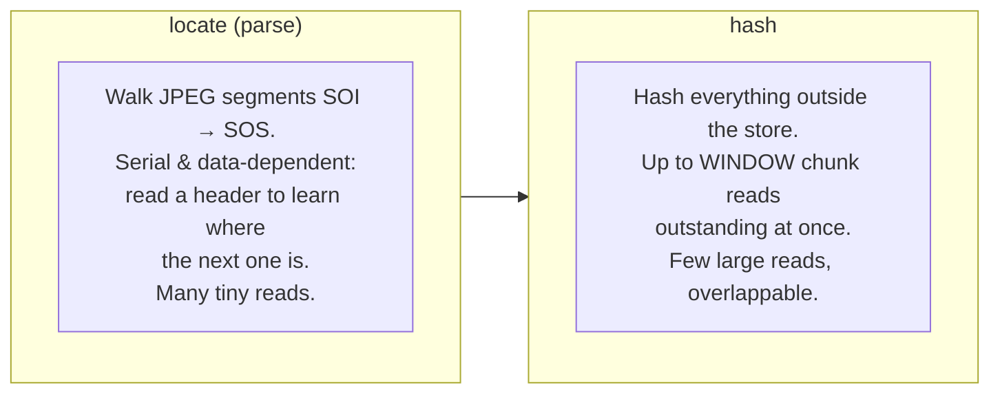

# 10. Concurrent hashing

Two experiments on the read path's hashing, and what they say about where
this architecture pays off. Both are driven by one benchmark,
[`c2pa-rs-compat-conformance/examples/bench_slow_storage.rs`](../../c2pa-rs-compat-conformance/examples/bench_slow_storage.rs),
which reads and validates a signed JPEG from *simulated* slow storage
(latency and per-connection bandwidth stand in for a network; nothing here
touches the wire, so runs are repeatable).

> **Why this is interesting at all.** The engine never does I/O: a session
> parks and emits a *set* of outstanding requests, and the host answers them
> in any order. The reader's hasher deliberately emits up to a *window* of
> chunk requests at once. So concurrency is entirely a **host** decision —
> the engine exposes the opportunity; whether to take it is policy. These
> experiments build a host that takes it, and measure when that was worth
> doing.

## The thing being exploited: two phases, two different costs

A file read has two phases with opposite shapes:

* **`locate` is serial.** You cannot parallelize it — each read's offset
  depends on the previous read's contents. Its cost is *per-request
  latency × number of tiny reads*.
* **`hash` is parallel.** The window lets several large reads be in flight
  at once. Its cost is *latency hidden behind overlap*, if the host overlaps.

The two experiments attack these two costs separately. Concurrency can only
help the hash phase; **readahead** is what makes the serial parse phase cheap.

## Configurable parameters

Everything a host can turn, and where the bound comes from:

| Parameter | Where | Range | Default | What it controls |
|---|---|---|---|---|
| `hash_chunk_size` | `ReadSettings` / `BuilderSettings` ([`ChunkSize`](../../contentauth-c2pa-primitives/src/chunk.rs)) | 4 KiB – 8 MiB | 64 KiB | Bytes per chunk request. Large amortizes round trips; small bounds memory. |
| `hash_window` | `ReadSettings` / `BuilderSettings` ([`HashWindow`](../../contentauth-c2pa-primitives/src/chunk.rs)) | 1 – 32 | 8 | Max chunks in flight. The ceiling on overlap. |
| worker threads | `read_manifest_concurrent(…, workers)` (host) | ≥ 1 (unbounded) | — | How many requests the host services at once. Capped in effect by `hash_window`. |
| readahead | host policy (`BufferedRangeSource` in the benchmark) | — | — | Collapse small serial parse reads into block fetches. **Not** an engine parameter. |

Peak hash-phase memory is `hash_window × hash_chunk_size` — at the maxima,
32 × 8 MiB = 256 MiB. The engine clamps both so no setting can make a
session misbehave; a value out of range is refused by `::new`, or snapped by
`::clamped`.

The benchmark adds its own CLI knobs for the *storage*, not the session:
`--size-mib`, `--latency-ms`, `--mib-per-sec`, `--block-kib`, `--runs`,
`--max-workers`.

## Experiment A — a concurrent host, and why it needed readahead

**Host.** `read_manifest_concurrent`
([`contentauth-c2pa-file-reader/src/concurrent.rs`](../../contentauth-c2pa-file-reader/src/concurrent.rs))
drives one `FileReadSession` but services its outstanding requests on a pool
of worker threads, fulfilling each as it arrives. The session is unchanged —
the *same* sans-I/O code every other host drives.

**First result: a regression.** Pointed straight at the ranged store, the
concurrent host was *slower* than c2pa-rs. The parse phase had become
hundreds of tiny, serial, high-latency round trips that no number of workers
could hide.

**The fix: readahead.** `BufferedRangeSource` wraps the store and splits
reads by size — small parse reads (< 16 KiB) are served from a cached
aligned block (one fetch covers dozens of segment headers), while large hash
chunks bypass the cache and stay concurrent. (Caching the hash chunks would
only serialize the overlap the host exists for.) The mechanism is one round
trip per block for the serial phase, and full fan-out for the parallel phase.

**Results** (16 MiB asset, 20 ms latency, 25 MiB/s per connection, 512 KiB
block, median of 3):

| scenario | time | requests | peak in-flight | vs c2pa-rs |
|---|---|---|---|---|
| c2pa-rs Reader, sequential stream | 4.22s | 96 | 1 | 1.00x |
| state-machine, sequential host | 2.83s | 64 | 1 | 1.49x |
| concurrent, 1 worker, readahead | 2.81s | 65 | 1 | 1.50x |
| concurrent, 2 workers, readahead | 2.16s | 65 | 2 | 1.95x |
| concurrent, 4 workers, readahead | 1.79s | 65 | 4 | 2.35x |
| concurrent, 8 workers, readahead | 1.62s | 65 | 8 | **2.60x** |
| concurrent, 8 workers, **no readahead** | 6.64s | 299 | 8 | 0.64x |
| concurrent, 8 workers, 64 KiB chunks | 2.26s | 288 | 8 | 1.87x |
| concurrent, 8 workers, 256 KiB chunks | 1.73s | 97 | 8 | 2.44x |
| concurrent, 8 workers, 4096 KiB chunks | 1.60s | 37 | 5 | 2.63x |

Readahead alone is the difference between the 0.64x regression and the 2.60x
win: 299 requests collapse to 65 with nothing else changed. Larger chunks
help further here (fewer round trips): 4 MiB chunks reach 2.63x.

**Negative control** (same asset, *zero* latency, unlimited bandwidth):
every row collapses to ~0.01s with peak in-flight 1 — on fast local storage
there is nothing to overlap and the extra threads are pure overhead.

**Repeatability across sizes** (20 ms, 25 MiB/s, 512 KiB, median of 2):

| asset | c2pa-rs | sequential | concurrent (8w) | concurrent speedup |
|---|---|---|---|---|
| 4 MiB | 1.13s | 0.76s (1.49x) | 0.48s | 2.37x |
| 16 MiB | 4.62s | 3.07s (1.50x) | 1.77s | 2.61x |
| 64 MiB | 18.35s | 11.33s (1.62x) | 6.37s | **2.88x** |

Consistent, and the advantage grows with size — the overlappable hash phase
grows while the serial `locate` overhead stays roughly fixed.

## Experiment B — making the in-flight window configurable

**Observation.** At 8 workers the speedup plateaus, because the engine's
window was a hard-coded `const WINDOW = 8`. Running 16 or 32 workers kept
peak in-flight pinned at 8 (2.62x → 2.59x → 2.62x): the extra threads idle.

**Change.** `WINDOW` became `hash_window: HashWindow` on the settings — a
clamped newtype (1 – 32, default 8) modelled on the existing `ChunkSize`,
threaded through both the reader's and builder's hashers. Default behaviour
is unchanged.

**Result** — the window sweep in the regime where 8 is a *shallow* pipeline
(16 MiB, 100 ms latency, 10 MiB/s, 64 KiB chunks, median of 3; c2pa-rs
baseline 14.80s, sequential 9.87s):

| `hash_window` | time | peak in-flight | vs c2pa-rs |
|---|---|---|---|
| 8 | 8.57s | 8 | 1.73x |
| 16 | 6.80s | 16 | 2.18x |
| 32 | 5.92s | 32 | **2.50x** |

Peak in-flight now rises past 8 and the time drops with it: the window was
the binding constraint whenever the bandwidth-delay product exceeds 8
chunks.

## A prerequisite finding (correctness before speed)

The first benchmark run disagreed with c2pa-rs — this workspace read the
asset `Valid`, c2pa-rs read it `Invalid`. The cause was **not** hashing: the
benchmark signed a manifest with no `c2pa.created` action, which c2pa-rs's
spec-2.x validation rejects (`assertion.action.malformed`). Fixing the
benchmark to sign a conformant manifest (via the baseline definition) made
the two agree, pinned by
[`sign_here_read_by_both.rs`](../../c2pa-rs-compat-conformance/tests/sign_here_read_by_both.rs).
A separate, still-open gap it exposed: **this workspace's reader does not
enforce the "first action must be created/opened" rule**, so it is more
lenient than c2pa-rs. (See [Future directions](09-future.md).)

## Inference

* **Two costs, two tools.** Concurrency overlaps the *hash* phase's waiting;
  readahead collapses the *parse* phase's round trips. Neither helps the
  other's phase. You need both to beat c2pa-rs on slow storage.
* **The window is the overlap ceiling** — worth raising only when the
  bandwidth-delay product is deeper than the current window.
* **None of it helps on fast storage.** With no latency, the sans-I/O
  session plus a simple sequential host is already ahead of c2pa-rs (~1.5x,
  from smaller, better-shaped reads), and the machinery adds only overhead.
* **The engine never changed.** Every row runs the identical `FileReadSession`;
  only the host differs. That is the architecture's claim, measured.

## Tradeoffs by host and storage

| Host / storage | chunk size | window | concurrency | readahead | Why |
|---|---|---|---|---|---|
| **In-memory / fast local disk** | default | 1–default | sequential host | off | Nothing to overlap; extra threads and buffers are overhead. |
| **High-latency object store / HTTP range** | large (1–8 MiB) | large (16–32) | concurrent, workers ≈ window | **on** | Overlap hides latency; readahead kills the serial parse round trips; big chunks amortize. |
| **Bandwidth-limited per connection** | large | large | concurrent | on | Many connections give aggregate bandwidth the hash phase can use. |
| **Memory-constrained (embedded, Wasm)** | small (down to 4 KiB) | small (down to 1) | sequential | optional | `window × chunk` is the memory bill; keep both small. |
| **Serial-only host (one cursor)** | moderate | 1 (effectively) | none | on | Can't overlap, but readahead still cuts parse latency. |

The engine's bounds (`ChunkSize` 4 KiB–8 MiB, `HashWindow` 1–32) keep every
combination safe: the worst case a host can ask for is 256 MiB of hash-phase
memory, and the best case for a constrained host is a single 4 KiB chunk.

**Back to:** [Findings](08-findings.md) · [Future directions](09-future.md)
