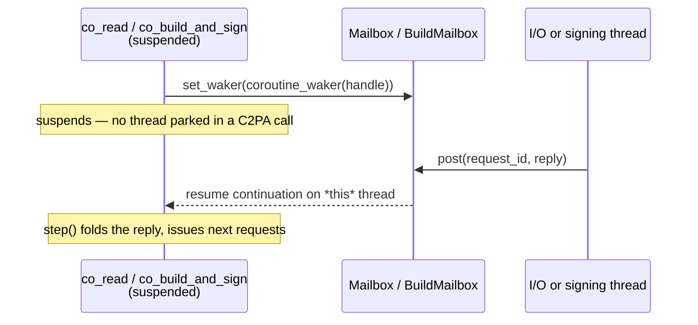

# 10. Evaluating the two C2PA workflows on one binding (C++)

The earlier pages argue that a sans-I/O `Session` — a synchronous state
machine that *asks its host* for bytes, the clock, the network, and
signatures instead of reaching for them — lets each binding choose its own
asynchrony. This page stops arguing and **measures**. It takes the two
workflows a C2PA toolkit exists to perform:

1. **Validate** the content credentials in a signed asset.
2. **Sign** an asset with content credentials.

and runs both through a *single* binding —
[`contentauth-c2pa-cpp`](../../contentauth-c2pa-cpp) — under three
concurrency models, to check three claims made for the architecture:

* **Threading** — a session can move between threads; many sessions run in
  parallel; one session's request *set* can be serviced concurrently.
* **Cancellation and progress without callbacks** — nothing is handed back
  into the engine; cancellation is destruction, progress is observation.
* **Promises, futures, and continuations** — the same engine sits behind a
  `std::future` and behind a C++20 coroutine whose continuation is resumed
  by whichever thread completes a request.

C++ is the right single binding for this: it is the only one that ships
*all three* driver families — blocking, thread-pool/`std::future`, and
coroutine — for *both* reading and signing, so one language exercises every
claim without changing the engine beneath it.

## What was run

All numbers below are from this repository on an Apple-silicon host
(macOS 26.6.2, AppleClang 17, OpenSSL 3.6.5), built and run with:

```sh
cmake -S contentauth-c2pa-cpp -B contentauth-c2pa-cpp/build -DC2PA_SM_FETCH_GTEST=ON
cmake --build contentauth-c2pa-cpp/build
ctest --test-dir contentauth-c2pa-cpp/build        # 105/105 pass
```

The suite is **105 tests, all passing** — the C++ core, the three thread
pools, blocking/pooled/future/coroutine reading *and* signing, and the four
`examples/` wired as end-to-end tests (`example_read`, `example_parallel`,
`example_sign`, `example_sign_mismatched_key`).

Both workflows reach the same engine through the flat C ABI in
[`include/contentauth_c2pa_sm.h`](../../contentauth-c2pa-cpp/include/contentauth_c2pa_sm.h)
(`c2pa_sm_session_*` + `c2pa_sm_reader_*`) and
[`include/contentauth_c2pa_sm_sign.h`](../../contentauth-c2pa-cpp/include/contentauth_c2pa_sm_sign.h)
(`c2pa_sm_build_session_*` + `c2pa_sm_sign_report_*`). Every request and
reply crosses that ABI as **plain data** — `C2PA_SM_REQUEST_{READ,LENGTH,TIME,OCSP}`
for reading, `C2PA_SM_BUILD_REQUEST_{READ,LENGTH,WRITE,SIGN,TIMESTAMP}` for
signing — and errors are returned *by value* through an `out_error`
parameter, never read from thread-local state. That one design choice is
what the rest of this page leans on.

## The two workflows, end to end

**Validate.** `Session(format[, settings_json])` plus a driver yields a
`Reader`; `Reader::validation_state()` returns a typed
`ValidationState::{Invalid, Valid, Trusted}` straight from the report,
without parsing JSON
([`c2pa_sm.hpp`](../../contentauth-c2pa-cpp/include/contentauth/c2pa_sm.hpp)).
`example_read` and `Core.a_signed_jpeg_reads_through_the_blocking_driver`
confirm the read path; `a_stream_and_a_file_read_the_same_as_memory` shows
the host's I/O shape does not change the answer.

**Sign.** `BuildSession(BuildSettings)` plus a build host produces a
`SignReport`; the host answers `Read`/`Length`/`Write` against the source
and output streams, and `Sign`/`Timestamp` with its own key and TSA. The
`example_sign` test signs the baseline JPEG and **reads it back**, requiring
`"validation_state": "Trusted"`:

```text
$ c2pa_sm_sign  C.jpg  signed.jpg  definition.json  signer.der  signer.key.pem  <notafter>
  "active_manifest": "urn:uuid:00000000-0000-4000-8000-000000000002",
  "validation_state": "Trusted",
```

Its negative twin, `example_sign_mismatched_key`, signs with a key that
does not match the certificate and requires an `Invalid` read-back and a
nonzero exit — so the round trip is proving validation, not merely
producing bytes.

## Claim 1 — Threading models

The host, not the engine, owns every thread. The same blocking build host
can be driven three ways, because a `Session` is just a value that is
advanced step by step.

| Driver | Reading | Signing | What it demonstrates |
|---|---|---|---|
| Blocking | `read(session, host)` | `build_and_sign(session, host)` | One thread, parked until done. |
| Thread pool | `read_parallel(session, host)` | `build_parallel(session, host)` | One session's *request set* fanned across a `PooledHost`. |
| `std::future` | `read_future(session, host)` | `build_future(session, host)` | The read/sign *is* a future. |
| Coroutine | `co_read(session, host)` | `co_build_and_sign(session, host)` | Suspends per request; see Claim 3. |

Session mobility is the load-bearing property, and it is *only* sound
because errors are values. `Core.a_session_moves_between_threads_between_calls`
creates a session on one thread and advances it on another; the coroutine
test `the_session_migrates_between_threads_but_never_runs_on_two_at_once`
lets a different thread resume it after each request — while the C ABI's
handle registry serializes borrows, so the engine is only ever touched from
one thread at a time (the header: *"any subset, and from any thread (one at
a time per session)"*).

Two axes of parallelism fall out, and the `parallel` example measures both
on a signed JPEG with 50 ms of simulated per-read latency:

```text
serial (blocking)          921 ms   15 reads, up to 1 at once
thread pool (8)            800 ms   15 reads, up to 3 at once
coroutine, same pool       815 ms   15 reads, up to 3 at once
16 assets, 8 I/O threads  1795 ms  240 reads, up to 8 at once
```

The first three lines are *within-session* concurrency: one validation's
independent reads overlap (1 → 3 at once) once the host has a pool to
service the request set. The last line is *across-session* concurrency: 16
validations share 8 I/O threads, 8 reads in flight at the peak — what
`Coroutines.many_reads_are_spawned_from_one_thread_and_share_a_few_io_threads`
asserts. Signing shows the same host-owned scheduling in
`AsyncSigning.serialized_build_work_does_not_park_the_other_pool_worker`.

The threading subset (`Core` mobility + `ThreadPool.*` + the migration and
pool coroutine tests + `AsyncSigning`) is **12/12 passing**.

> **Caveat.** Within-session overlap only appears if the host services the
> whole outstanding set, not one request at a time; the serial line above
> is exactly the "up to 1 at once" case. Bindings should expose
> *"service the set"*, which both pooled drivers already do.

## Claim 2 — Cancellation and progress, without callbacks

c2pa-rs's `Context` carries a progress callback (`bool(phase, step, total)`)
and a `cancel()` callable from another thread — both of which impose rules a
binding must forward: the callback must not throw, and the `Context` must
outlive any in-flight work. This binding has neither, by design, and the
tests show nothing is lost:

* **Cancellation is destruction.** There is no `cancel()` because there is
  nothing to interrupt — no thread parked inside a C2PA call, no lock.
  `Core.cancelling_a_read_with_requests_in_flight_is_safe` and
  `Coroutines.destroying_a_suspended_coroutine_cancels_the_read` drop a
  read mid-flight; `coroutine_signing_cancellation_keeps_owned_requests_and_late_callbacks_safe`
  does the same for signing. Replies that were already dispatched land in a
  `Mailbox`/`BuildMailbox` that outlives the session, so a late completion
  has somewhere valid to go rather than a dangling frame
  (`build_mailbox_preserves_replies_when_wakers_throw_and_discards_them_on_cancel`).
* **Progress is observation.** The outstanding-request set between `step()`s
  *is* the progress signal — how many reads are in flight, how many bytes
  asked for — so the engine never calls back out to report it.
* **No callback crosses the ABI.** Requests and replies are plain structs;
  a host failure is a `Failed{message}` *value* the engine interprets (it
  fails open for OCSP, errors a read), not an exception that must not cross
  (`Core.a_host_that_fails_a_read_fails_the_read_not_the_process`,
  `Core.missing_throwing_and_invalid_signers_fail_the_build`).

The cancellation/progress subset is **8/8 passing**.

> **Honest limit.** Cancellation granularity is the request boundary: a
> request already handed to a worker (a blocking read, an OCSP or timestamp
> round trip) runs to completion in the host; the host must cancel its own
> in-flight I/O. And progress is *observational* — there is no structured
> "percent complete" from the engine yet. Both are recorded in
> [Future directions](09-future.md).

## Claim 3 — Promises, futures, and continuations

This is where the "async lives in the host" claim is most concrete. The
engine is synchronous; the *drive loop* is a future or a coroutine, and the
continuation is decoupled from any one thread.

**Futures.** `read_future` returns `std::future<std::optional<Reader>>` and
`build_future` returns `std::future<SignReport>` — the validation or the
signature *is* a value you wait on. `Core.a_read_can_be_a_future_and_many_can_run_at_once`
and `Core.build_futures_own_progress_and_deliver_standard_and_nonstandard_start_errors`
cover both, including errors surfacing through the future.

**Coroutine continuations.** `co_read` / `co_build_and_sign` are, in the
README's words, *"step(); co_await reply; repeat"*. The mechanism is a
mailbox and a registered continuation: a reply may be *posted from any
thread*, and `coroutine_waker(handle)` is the continuation that resumes the
suspended frame on whichever thread delivered the reply
([`c2pa_sm_coro.hpp`](../../contentauth-c2pa-cpp/include/contentauth/c2pa_sm_coro.hpp)).



`Coroutines.coroutine_signing_pool_resumes_await_chain_on_delivery_thread`
asserts exactly that resume-on-the-delivering-thread behavior for signing;
`a_single_thread_can_drive_a_coroutine_by_completing_its_requests` shows the
same continuation works with no extra threads at all; and
`get_may_free_the_frame_the_instant_the_task_completes_on_another_thread`
pins down the cross-thread lifetime of the frame. `coroutine_signing_inline_get_returns_owned_trusted_report`
closes the loop by signing through a coroutine and getting a `Trusted`
report back.

The promises/futures/continuations subset is **9/9 passing**.

## Verdict

For both workflows, on one binding, the three claims hold empirically:

| Claim | Validate | Sign | Result |
|---|---|---|---|
| Threading (mobility, pools, fan-out) | `read` / `read_parallel` / `read_future` / `co_read` | `build_and_sign` / `build_parallel` / `build_future` / `co_build_and_sign` | 12/12; fan-out 1→8 at once |
| Cancellation + progress, no callbacks | drop a read; observe between steps | drop a build; late replies safe in mailbox | 8/8 |
| Promises / futures / continuations | future + coroutine, resume on delivery thread | future + coroutine, resume on delivery thread | 9/9 |

The engine never changed between models — the same `Session` sits behind a
blocking call, a `std::future`, and a coroutine, for reading and for
signing, with a `Trusted` round trip at the end. The cost the model asks of
a binding is real but small: expose *"service the request set"* rather than
*"next request"*, and accept that cancellation and progress are things the
host *observes* rather than things the engine *announces*.

### Environment limitation

CI exercises both workflows under AddressSanitizer and ThreadSanitizer on
Linux. On the macOS 26.6.2 / AppleClang 17 host used here, the sanitizer
*runtimes* fault at process startup (TSan segfaults, ASan hangs) regardless
of the test — a toolchain/OS incompatibility independent of this code — so
the sanitizer runs for this evaluation are the Linux CI job, not this host.
The un-instrumented, heavily-threaded runs above all pass.

**Next:** back to the [walkthrough index](README.md), or
[Future directions](09-future.md) for what the two remaining caveats
(structured progress, request-boundary cancellation) would take.
