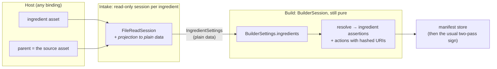

# 10. Ingredients

How C2PA *ingredients* — the assets an asset was made from — fit this
architecture, from the engine up through the compatibility layers. This is
a **design page with a progress report**: the plan is whole, the code is
partial, and the status table at the end says which is which.

> **Temporary limits are marked "TEMPORARY"** throughout this page and in the
> code's own documentation. They are staging, not design.

## What the specification asks of a claim generator

Section names are those of the C2PA Technical Specification (2.x):
*Standard Assertions → Ingredient*, *Validation → Validate the Ingredients*,
*Claims → Adding Ingredients*, *Assertions → Redaction of Assertions*,
*Unique Identifiers → Versioning Manifests Due to Conflicts*.

* **An ingredient assertion** (`c2pa.ingredient.v3`, then `__1`, `__2`, …)
  records a `relationship` — `parentOf`, `componentOf` or `inputTo` — and,
  if the ingredient carried a manifest, hashed URIs to that manifest's box
  (`activeManifest`) and its claim signature box (`claimSignature`). It
  *may* carry a thumbnail, data, a title, a format and an instance id. An
  ingredient with **no** manifest may instead carry a `digitalSourceType`;
  the two are mutually exclusive.
* **The generator is also a validator.** Adding an ingredient that has a
  manifest means fully validating it, and recording the outcome in the
  assertion's `validationResults` (with `ingredientDeltas` for *its*
  ingredients). The field is required whenever `activeManifest` is present.
* **Its manifests travel with it.** Every manifest in the ingredient's store
  is copied, byte for byte, into the new store, ahead of the new manifest
  (which stays last). A manifest already present is skipped if identical;
  if different, it is re-labelled (`…:1_1`); redactions are merged.
* **Actions tie it together.** A `parentOf` ingredient is the subject of the
  first action of the first *created* actions assertion, `c2pa.opened`; each
  `componentOf` is the subject of a `c2pa.placed`. Both name the ingredient
  assertion by hashed URI. At most one `parentOf` (`manifest.multipleParents`).
  A parent's assertion is *created*; others are *gathered* by default.

## What c2pa-rs does, and what we keep from it

c2pa-rs reads an ingredient **when it is added**
(`Builder::add_ingredient_from_stream`): it validates the asset, pulls out
its manifest bytes, and keeps those — not the stream. Signing later needs no
ingredient I/O. Actions name ingredients by a symbolic label
(`parameters.ingredientIds`) which `to_claim` swaps for hashed URIs, because
the hash is not known until the assertion is built. It also adds the
`opened`/`placed` actions itself, and with `Edit` intent treats the source
as the parent.

All three ideas carry over. The first is the one that shapes everything
else here.

## The design

**1. Intake is its own session, not a stage of the builder.** An ingredient
is read by an ordinary `FileReadSession` against *its own* stream — every
session sees its own `PRIMARY_STREAM`, so nothing needs multiplexing — and
the result is projected into plain data. This matches c2pa-rs's add-time
semantics, which is what lets each binding keep its own shape:

| Binding | Where intake runs |
|---|---|
| `rs-compat-sign` | `add_ingredient_from_stream` runs the session to completion with a blocking host, right there, as c2pa-rs does |
| `js-compat-sign` | `addIngredientFromBlob` awaits the same session, with `Blob` reads |
| `node-compat-sign` | a synchronous intake wrapper hands plain data to Node, which ran every read |

The auto-parent of c2pa-rs's `Edit` intent is the same intake run on the
source before the build, chained by the host. (Folding that into
`FileBuilderSession` would make the file builder depend on the reader; we
chose not to.)

**2. `BuilderSession` stays pure.** `BuilderSettings::ingredients` carries
everything the builder needs; the builder does the rest with no new host
request:

* renders one `c2pa.ingredient.v3` per ingredient (a parent *created*, the
  rest *gathered* unless `created` is set);
* resolves `parameters.ingredientIds` in the host's `c2pa.actions.v2` to
  real hashed URIs — the one place the builder interprets an assertion
  instead of treating it as opaque CBOR, justified because only the builder
  knows the hash;
* with `auto_ingredient_actions` (on by default, as in c2pa-rs), adds the
  `c2pa.opened` / `c2pa.placed` actions that are missing.

An ingredient assertion's hashed URI depends only on its own bytes, never on
the hard binding, so it is final when the placeholder is built. The
two-pass scheme needs **no change**.

The hard binding is also untouched: `plan_embed` already replaces any old
store, so the new binding excludes only the new store, and the parent was
validated against its own bytes at intake.

**3. `ValidationResults` lives in `contentauth-c2pa-primitives`.** The reader
*produces* it (from a `ReadReport`) and *consumes* it (from an existing
ingredient assertion, to merge); the builder *encodes* it. That is exactly
the "genuinely shared" bar the primitives crate holds itself to. *(Planned;
not in the code yet.)*

**4. The reader checks first.** The writer's round-trip proof reads back what
it wrote, so the reader has to be able to say an ingredient is wrong before
the builder is trusted to write one. And `c2pa-rs-compat-conformance` is an
outside check in both directions.

## What the reader checks today

For every manifest in a store (not only the active one):

| Check | Status code |
|---|---|
| Assertion has a valid `relationship`, not both `activeManifest` and `digitalSourceType`, and (v3) `validationResults` with `activeManifest` | `assertion.ingredient.malformed` |
| At most one `parentOf` | `manifest.multipleParents` |
| `activeManifest` is in the store and hashes as recorded | `ingredient.manifest.validated` / `.mismatch` / `.missing` |
| `claimSignature` likewise; alone, where an assertion in that manifest was redacted | `ingredient.claimSignature.*` |
| In a **v2** claim, `c2pa.opened` names exactly one `parentOf` ingredient of the same manifest, `c2pa.placed` one or more `componentOf`, and the references hash as recorded | `assertion.action.ingredientMismatch`, `assertion.hashedURI.mismatch` |
| No manifest, and not `inputTo` | `ingredient.unknownProvenance` (informational) |

Older claims are not held to the action rules, as in c2pa-rs outside its
strict mode. The decoded assertions are on `Manifest::ingredients`.

## Status and plan

| Stage | What | State |
|---|---|---|
| 1 | Reader: decode ingredient assertions; the checks above | **Done** |
| 2 | Builder: ingredients with no manifest — assertions, `ingredientIds`, auto `opened`/`placed`; `sign-baseline` `ingredients`; reachable through `rs-compat-sign` | **Done** |
| 2 | Thumbnails and `data` (embedded-data assertions use binary content boxes, not CBOR) | Next |
| 3 | Intake session; ingredients **with** a manifest: copy the store verbatim (a raw JUMBF box — `ToBox` is public in the `jumbf` crate, not yet spiked), `activeManifest`/`claimSignature`, `validationResults` (active manifest only), skip identical duplicates | Next |
| 3 | **TEMPORARY:** a manifest whose label collides with a *different* one already in the store is an **error**, not re-labelled | Next |
| 3 | `add_ingredient_from_stream` / `addIngredientFromBlob` / Node intake wrapper | Next |
| 4 | Reader recursion and `ingredientDeltas`; re-labelling; redaction (rewriting the copied manifest's assertion store); `assertion.notRedacted` | Later |
| 4 | Until reader recursion lands, an ingredient whose store itself has ingredients cannot get a complete `validationResults` | Later |
| 5 | Archives (`write_ingredient_archive`), update manifests, soft-binding ingredients | Later |

## Things worth knowing

* **Only `c2pa.actions.v2` is linked.** A v1 `c2pa.actions` names a single
  ingredient under `parameters.ingredient`; nothing writes v1.
* **The builder invents no identifiers.** An ingredient's `instanceID` is
  written only if the host supplies one — for the same reason the manifest's
  own must be supplied: the engine has no RNG.
* **The ingredient label is not in the manifest.** It exists only to link an
  action to an ingredient in settings (c2pa-rs's `ingredientIds`).
* **Spec snapshot.** The specification itself is not vendored in this
  repository; names above are by section.

**Back to:** [Future directions](09-future.md)
