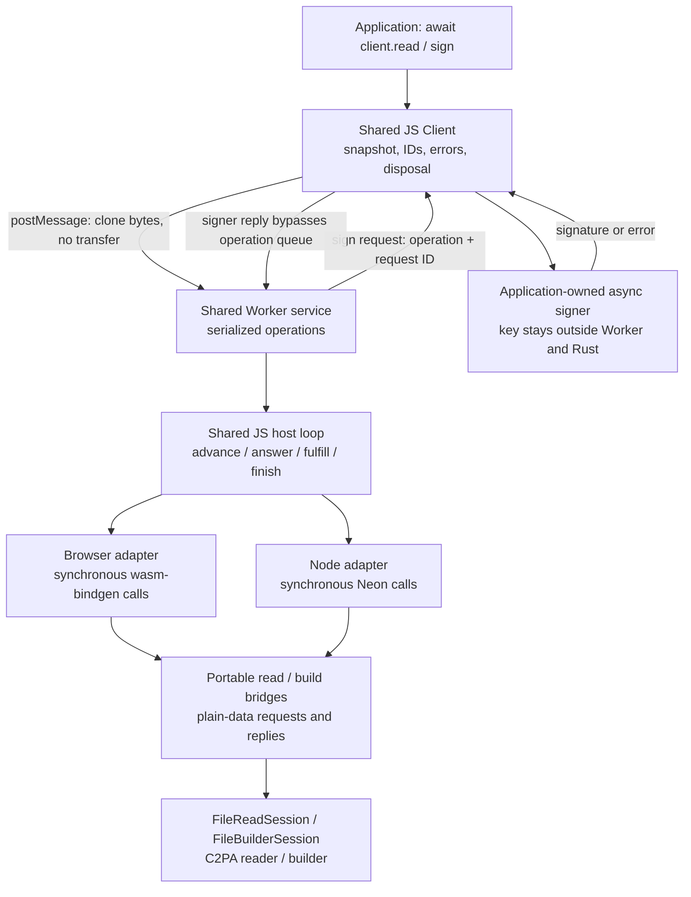
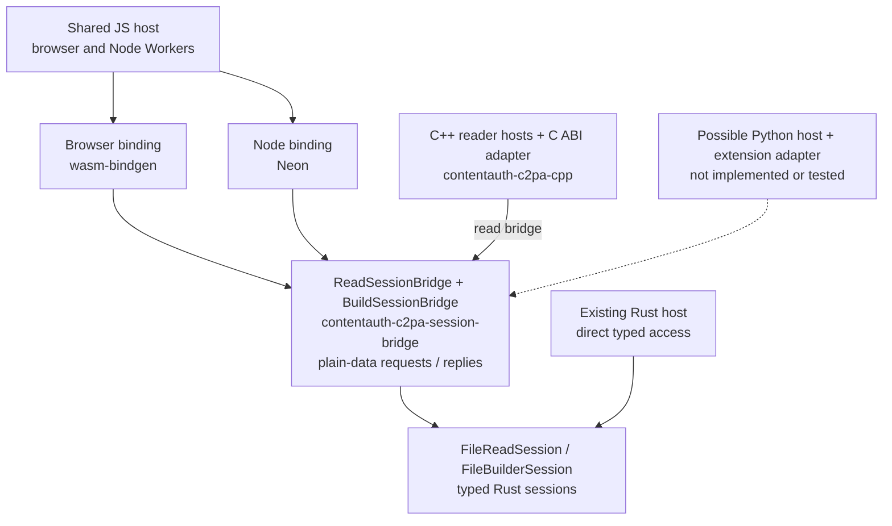

# Shared JavaScript host over Wasm and Neon

## Scope and status

Use one JavaScript facade, Worker protocol and session-driving loop in both
environments. Run that loop in a browser module Worker over Wasm, or a Node
`worker_threads.Worker` over Neon. Rust remains synchronous and sans-I/O.
Neither Tokio nor a custom scheduler is required for this example.

This is a **read and baseline-signing architecture proof**, not a replacement
SDK or a legacy API migration. Reading exercises validation, settings and
reporting; signing exercises source/output I/O requests and an asynchronous
caller-owned signer across the Worker boundary. Both use existing Rust domain
functionality, with shared JavaScript transport, isolation and lifecycle logic.
Signing is limited to the existing JPEG/ES256 baseline, without timestamps.

This package originated as a proof on branch `ale/shared-worker-poc`, based on
`main` at `97fac9b`. Its implementation, fixtures and generated artifacts now live in this
package; the standalone Wasm binding is in the
repository-level `contentauth-c2pa-wasm` crate. No migration-branch changes or
domain features were copied.

## Architecture



The application and service are in different execution realms. Platform files
only start Workers, normalize message/error/termination APIs and translate
binding values. The **same imported modules**, not parallel implementations,
own these behaviors:

| Module | Shared responsibility |
| --- | --- |
| [client.mjs](src/shared/client.mjs) | Public Promise API; request identity; input snapshot; signer callbacks; reply/error handling; disposal |
| [service.mjs](src/shared/service.mjs) | Worker command dispatch; serial operation queue; independently dispatched signer replies |
| [drive.mjs](src/shared/drive.mjs) | Read/build session progression; source/output bytes; host replies; request accounting; cleanup |
| [contract.mjs](test/contract.mjs), [signing.mjs](test/signing.mjs) | Identical read and signing acceptance checks in Node and all three browsers |

The runtime-neutral
[`contentauth-c2pa-session-bridge`](../contentauth-c2pa-session-bridge/)
crate owns `ReadSessionBridge` and `BuildSessionBridge` with their plain-data
request/reply types and shared compatibility context/report types. The
standalone [Wasm binding](../contentauth-c2pa-wasm/src/lib.rs) consumes the
read bridge, and its [signing boundary](../contentauth-c2pa-wasm/src/build.rs)
consumes the build bridge. Both remain synchronous; neither duplicates C2PA
logic or adds a Rust async runtime.

Wasm serializes request metadata as JSON but passes bulk build write payloads
as binary byte arrays through wasm-bindgen. Each payload is consumed once
before the next advance; byte storage remains owned/copied, not an unsafe view
into Wasm memory. Neon returns objects and expects Buffers for byte replies.
Adapters normalize those differences without changing the shared host.
Small signing-input and final manifest arrays still use JSON in the Wasm
adapter. The original all-JSON path remains only as an experiment control.

### Neutral session bridge

The bridge crate now owns the read and build workflows plus their
`PendingRequest`, `Reply` and `Step` vocabularies, the signing `Stream` and
`SignReport`, and compatibility context/report/error types. Its
[read bridge](../contentauth-c2pa-session-bridge/src/read/mod.rs) and
[build bridge](../contentauth-c2pa-session-bridge/src/build/mod.rs) adapt the
typed file sessions for language bindings: they map opaque engine request IDs
to numeric handles, surface each new request once, translate replies, and
return the compatibility results. They do not call Node APIs, use Neon, perform
I/O, spawn threads, or schedule work. Byte reads, length, clock, OCSP,
timestamps and signing remain host responsibilities.

The historical Node association was API-shaped: the first wrapper accepted
c2pa-node-style format/settings arguments and mapped a missing manifest to
`None` for the JS `null` result. The same compatibility contract is now owned by
the neutral bridge and consumed by both bindings. Compatibility policy remains
above the generic state-machine engine; the bridge is not a Worker, host driver,
scheduler or new validation engine.

Node-specific code should remain in the Neon binding and Node host/Worker
adapter; browser-specific code should remain in the Wasm binding and browser
host/Worker adapter. The shared JS driver continues to use the same bridge
protocol in both.

### Reuse beyond JavaScript

The bridge is language-neutral, not merely shared between two
JavaScript runtimes. A C++, Python, Swift, Kotlin or C# host could use the same
`advance` / `fulfill` / `finish` protocol, answering requests with its own I/O,
clock and networking APIs and choosing its own concurrency model. Promises,
Workers and JavaScript event loops are not requirements of that protocol.

The existing Rust enums, strings and byte vectors are **not a universal
foreign-function ABI**. Each language still needs a thin adapter for value/error
conversion, session ownership and disposal, and exact representation of 64-bit
offsets and request handles. Neon and wasm-bindgen provide the two adapters
exercised here; another language would need its own binding tooling or a
deliberately designed C ABI.

Protocol reuse must also be distinguished from legacy API compatibility. The
current wrapper carries c2pa-js-oriented settings JSON, report/error shapes and
missing-manifest behavior. Other languages may reuse those conventions, but
should not have to adopt them just to drive the state machine. Keep legacy
compatibility facades separate from the reusable session protocol; existing
Rust hosts can already use the underlying typed sessions directly.

The JavaScript experiments prove the two JS consumers. The subsequently merged
[C++ reader binding](../contentauth-c2pa-cpp/) also drives the neutral read bridge
through its own C ABI and hosts, not this JS package. Python and a universal ABI
remain unimplemented; no further abstraction is required for those possibilities.

The following is the current ownership model. The dotted Python path is a
possible, unproven additional consumer.



## Ownership and execution

- One Worker per client. Workers are reused; top-level operations are queued.
  Pending requests within one operation can be answered as a batch.
- Native handles and Wasm objects never cross Worker boundaries. Results are
  plain reports and, for signing, output/manifest bytes and exclusion ranges.
- `read()` and `sign()` copy input before their first await, then use structured cloning.
  Caller buffers remain attached and mutation cannot change a queued read.
  This costs memory and synchronous caller work proportional to input size.
- Signing also snapshots the definition and public certificates. The signer
  function and private key stay in the application realm. Only the COSE signing
  input and raw signature/error cross the Worker protocol.
- Build output is buffered in a growable in-memory array inside the Worker.
  `ArrayBuffer.transferToFixedLength` moves/shrinks it to the exact logical
  length, then the Worker transfers its backing buffer rather than cloning its
  payload. No spare capacity is exposed and callers receive the same Uint8Array
  result type. This requires that API (Node 22+ and the tested browsers).
  The VM may copy while shrinking; this is not a physical zero-copy guarantee.
  For N output bytes, the change removes N structured-clone payload-copy bytes
  and the explicit JS trim copy, not necessarily N or 2N of peak memory.
  Geometric output growth still copies; this is not file-backed/constant-memory.
- This proof accepts in-memory JPEG bytes only. It does not promise streaming
  input, constant memory, zero-copy transfer or free result transport.
- Successful `finish` consumes the Rust session. Wasm wrappers are explicitly
  freed in `finally`; Neon error handles become eligible for isolate GC.
  Client disposal terminates its Worker, releasing that isolate's resources.
- Disposal rejects pending calls. It is **abrupt termination**, not graceful
  cancellation. There are no external file writes or Worker-owned network
  operations. Caller-owned signing cannot be cancelled by terminating the
  Worker; its late success/rejection is consumed without posting a reply.
- No periodic task yields are inserted. A busy Worker can delay its own control
  messages; the application remains on a separate event loop. Responsive
  cancellation/progress or concurrent shared-Worker execution is not promised.
- OCSP, timestamps and unrecognized host requests fail explicitly. Core
  validation and manifest generation remain Rust-owned.

### Signer callbacks and queueing

```mermaid
sequenceDiagram
    participant A as Application / shared client
    participant W as Worker / shared service
    participant R as Rust builder via Wasm or Neon
    A->>W: build(operation ID, source, definition, certificates)
    W->>R: advance / fulfill byte requests
    R-->>W: Sign(request ID, algorithm, COSE bytes)
    W->>A: signer request(operation ID, request ID)
    Note over W: Build awaits reply; message handler stays available
    A->>A: await caller-owned signer
    A->>W: signature or error(operation ID, request ID)
    Note over W: Dispatch reply outside top-level operation queue
    W->>R: fulfill signature, advance, finish
    W-->>A: signed bytes, manifest, exclusions, statistics
```

Top-level reads/builds are serialized, but signer replies are not top-level
operations. Queueing a reply behind its own waiting build would deadlock.
Replies must match both the operation ID and the Rust request handle.
Signer throws/rejections preserve their name/message across the protocol, not
their original object identity or stack.

A callback must not await another operation on the **same client**: that
operation is queued behind the build awaiting the callback. Use a separate
client for such work. A signer that never settles blocks its client's queue
until disposal; signer/network timeouts are caller policy, not an automatic
timeout or cancellation guarantee of this proof.

## Run the proof

Prerequisites: Rust 1.96+, the `wasm32-unknown-unknown` target, Node 22+, and
`wasm-bindgen-cli` **0.2.122**. The Wasm dependency is pinned to the CLI schema;
other versions require changing both together.

From this directory:

```sh
rustup target add wasm32-unknown-unknown
# Only if the matching CLI is not already installed:
cargo install wasm-bindgen-cli --version 0.2.122 --locked
npm ci
npx playwright install chromium firefox webkit
npm run build:bindings
npm run fixtures
npm test
npm run test:browser
```

The independent Neon and Wasm workspaces are not built by root `cargo test`.
`fixtures` builds the existing signing addon, generates small and 64 MiB signed
assets with the repository's public TEST ONLY ES256 credentials, and checks
their full reports against the existing direct Node host. It requires no
external service and does not add signing functionality to Rust.
It also records the direct signer's exact COSE input/algorithm and exclusion
ranges, and exports the repository's public TEST ONLY key in PKCS#8 form for the
application-side WebCrypto test signer. Never substitute production credentials
in these generated fixtures.

An application uses the same calls with a different platform entry:

```js
// Node: "./src/node/client.mjs"; browser: "./src/browser/client.mjs"
import { createClient } from "./src/node/client.mjs";

const client = createClient();
try {
  const { report, stats } = await client.read(bytes, {
    settings: { verify: { ocsp_fetch: false } },
  });
  console.log(report, stats);
  // definition supplies the baseline title, instance_id, label, generator
  // and c2pa.created assertion; privateKey is an application-held P-256 key.
  const signed = await client.sign(unsignedJpeg, definition, {
    alg: "es256",
    certs: [certificateDer],
    async sign(data) {
      return new Uint8Array(await crypto.subtle.sign(
        { name: "ECDSA", hash: "SHA-256" }, privateKey, data));
    },
  });
  console.log(signed.asset, signed.manifest, signed.exclusions);
} finally {
  await client.dispose();
}
```

Run the browser entry through an HTTP server; the acceptance runner supplies a
loopback-only server. The proof clock is restricted to signed 32-bit Unix
seconds by its small Wasm bridge; current dates and frozen fixture time fit.

## Acceptance and findings

`npm test` and `npm run test:browser` must actually load the native addon and
Wasm. No mocks substitute for the read/build boundaries. The shared read contract checks:

1. Complete report equality with the existing direct Neon host, including
   `Trusted`, signature and data-hash statuses.
2. Exact session read counts, bytes and advance counts across Node/Wasm.
3. Input snapshotting without detaching the caller's bytes.
4. Unsigned JPEG returning `null`.
5. Invalid settings and malformed asset rejection, followed by successful reads.
6. Last-byte tampering returning `Invalid`.
7. Two queued operations returning the correct independent reports.
8. Application timer progress during three repeated 64 MiB reads.
9. Disposal rejecting a pending operation and subsequent calls.
10. A second Worker continuing after the first client is disposed.

The [shared signing contract](test/signing.mjs) additionally proves:

- Full trusted read-back for small and 64 MiB signed assets, matching direct
  host reports, output/manifest lengths and hard-binding exclusions.
- Exact COSE signing input and algorithm equality with the existing direct
  signing host; randomized signatures need not be byte-identical.
- A caller-owned, non-extractable WebCrypto key works in all four environments.
- Input/definition/certificate snapshots, delayed callbacks and application
  task progress while a build awaits its signature.
- Synchronous throws, asynchronous rejections, invalid reply types/lengths,
  malformed definitions and subsequent successful operations.
- A 64-byte but invalid signature reads `Invalid`: reply-shape checks do not
  establish cryptographic correctness or make build success a trust verdict.
- Queued mixed reads/builds route correctly, and a second Worker can finish a
  different build while the first Worker's signer remains pending.
- Disposal rejects a pending build; both late signer success and rejection are
  safely handled without affecting another client.

The Node tests additionally exercise startup/crash and callback transport
failures, plus assert that neither late callback outcome posts to a disposed
port. These controlled port tests are not native-process crash tests.

The architecture works in Node and Chromium/Firefox/WebKit. Importantly,
**Neon loads inside a Node Worker without a Rust runtime or binding rewrite**.
Both adapters use the same pre-existing Rust sessions and the same JS host.
The 64 MiB asset needs 1,029 reads totaling 67,110,652 bytes, at most 64 KiB per
read, and 137 advances, identically across all four environments.

### Binary write-payload experiment

The browser adapter defaults to binary bulk write payloads.
`createClient({ transport: "json" })` selects the original boundary solely for
the experiment; it is not a proposed SDK configuration surface. Both paths use
the same Wasm binary, Rust session, JS driver, signer and fixtures.

`npm run test:browser` now runs the unchanged read/signing contracts against
**both** boundaries in all three engines, then runs
[the paired comparison](benchmarks/boundary.mjs): one warmup per size/transport and
four measured pairs per size, alternating which transport goes first.
Small and 64 MiB inputs yield 16 measured builds per browser, 48 total. Every
sample checks direct-host signing inputs, read-back report, output/manifest
lengths, exclusion ranges and identical request accounting outside the timed
build interval. Node remains the unchanged native reference.

Results include `transports` (both contract runs) and `comparison.samples`
(paired measurements). Browser build results expose a proof-only `boundary`
measurement:

- `wasmAdvanceMs`: Rust advancement, JSON construction/serialization and string
  transfer together, not isolated serialization time.
- `parseMs`: JavaScript `JSON.parse`.
- `payloadMs`: payload conversion/copy plus request normalization; binary uses
  an additional wasm-bindgen byte retrieval call.
- `metadataChars`, `writePayloadBytes`, `writes`: transport/accounting checks.

The local comparison reduced median large-build caller duration by about
6.7–8.5 times in all browsers; binary is retained as the default. Small builds
were too short/timer-quantized for strong performance claims.

### Performance interpretation

Ignored `results/{node,chromium,firefox,webkit}.json` records three warm measured
reads and three builds, task progress, caller/Worker duration and input/binary/source
fingerprints, plus the paired boundary comparison described above.
Timing is **not** a pass threshold. The only scheduling assertion is that
application tasks actually run before the read completes.

The synthetic asset is JPEG framing plus a zero-filled tail signed using the
existing core. This exercises logical hashing, not realistic image metadata,
physical I/O, a legacy comparison or cold-start distributions. Caller time
includes input snapshot/cloning, queueing, report transfer and parsing;
Worker time includes session construction, hashing and report serialization;
build time also includes output assembly and the awaited application signer.
Their difference is not an isolated FFI cost.

Worker isolation does not remove copying: each read snapshots and clones the
entire asset. Large messages can still briefly occupy the calling thread.
No peak memory or frame-deadline guarantee is established.

## Deliberate non-goals and next trigger

No new domain validation, formats, compatibility shims, identity/timestamp
support, network hosts, worker pools, custom schedulers, public cancellation
API or streaming-storage abstraction. No production publication.

The binary experiment identifies a large avoidable binding cost, not the cause
of every remaining native/browser difference. Next, measure peak memory and
copying across input sizes before selecting file/Blob-backed sources/outputs.
The proof still buffers entire assets and wasm-bindgen still copies payload
bytes. No core async conversion is needed. Do not add cooperative Worker
scheduling without a required message/progress behavior that fails a test.
