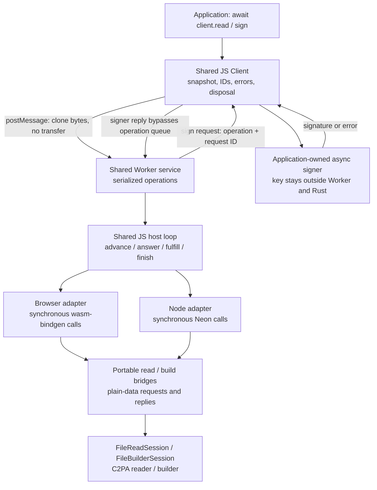
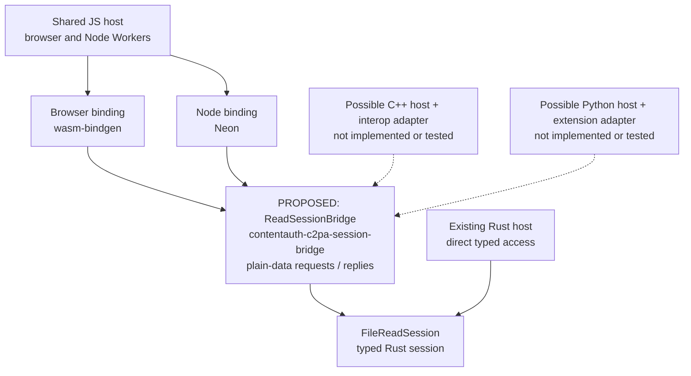

# Shared JavaScript host over Wasm and Neon

## Proposal and scope

Use one JavaScript facade, Worker protocol and session-driving loop in both
environments. Run that loop in a browser module Worker over Wasm, or a Node
`worker_threads.Worker` over Neon. Rust remains synchronous and sans-I/O.
Neither Tokio nor a custom scheduler is required for this example.

This is a **read and baseline-signing architecture proof**, not a replacement
SDK or a legacy API migration. Reading exercises validation, settings and
reporting; signing exercises source/output I/O requests and an asynchronous
caller-owned signer across the Worker boundary. Both use existing Rust domain
functionality, with shared JavaScript transport, isolation and lifecycle logic.
Signing is limited to the existing JPEG/ES256 baseline, without timestamps.

The branch starts from `main` at `97fac9b`. No migration-branch changes or domain
features were copied. The original experimental worktree remains untouched.

## Architecture



The application and service are in different execution realms. Platform files
only start Workers, normalize message/error/termination APIs and translate
binding values. The **same imported modules**, not parallel implementations,
own these behaviors:

| Module | Shared responsibility |
| --- | --- |
| [client.mjs](shared/client.mjs) | Public Promise API; request identity; input snapshot; signer callbacks; reply/error handling; disposal |
| [service.mjs](shared/service.mjs) | Worker command dispatch; serial operation queue; independently dispatched signer replies |
| [drive.mjs](shared/drive.mjs) | Read/build session progression; source/output bytes; host replies; request accounting; cleanup |
| [contract.mjs](test/contract.mjs), [signing.mjs](test/signing.mjs) | Identical read and signing acceptance checks in Node and all three browsers |

The existing `NodeSession` name describes its original consumer, not a runtime
dependency. It already compiles to Wasm. The small standalone
[Wasm crate](wasm/src/lib.rs) exposes that same synchronous session; it does not
use the existing browser async host or duplicate C2PA logic. The
[naming proposal below](#proposed-neutral-session-name) records how to make that
shared role explicit; the rename/extraction is not part of this proof.
The [signing Wasm boundary](wasm/src/build.rs) likewise wraps the existing
`NodeBuildSession`, without adding builder behavior or a Rust async runtime.

Wasm serializes requests as JSON, including build write payloads as byte arrays.
Neon returns objects and expects Buffers for byte replies. Adapters normalize those differences. This is a
deliberately simple boundary, not a claim of optimal serialization performance.

### Proposed neutral session name

**Proposal, not yet implemented:** rename `NodeSession` to `ReadSessionBridge`
and move its shared request/reply surface into a runtime-neutral
`contentauth-c2pa-session-bridge` crate when promoting this proof into a shared
SDK.

The current [session wrapper](../contentauth-c2pa-node-compat/src/session.rs)
adapts `FileReadSession` for a binding boundary. It selects the supported format,
parses compatibility settings, maps opaque engine request IDs to numeric host
handles, reports each new request once, translates replies, and returns the
compatibility reader result. It does not call Node APIs, use Neon, perform I/O,
spawn threads, or schedule work. Byte reads, length, clock and OCSP transport are
host responsibilities, not inherently Node-specific operations.

The Node association is historical and API-shaped: the wrapper originated in
the Node compatibility crate, accepts c2pa-node-style format/settings arguments,
and maps a missing manifest to `None` for the JS `null` result. The proof's
browser adapter now uses that same contract. Portability does not make these
compatibility choices part of the generic engine.

`ReadSessionBridge` names both the workflow and the responsibility: adapting a
reader session into a plain-data binding contract. `NodeSession` suggests a
runtime restriction that does not exist; `ReadSession` alone would obscure the
distinction from the underlying reader sessions. The bridge is not a Worker,
host driver, scheduler or new validation engine.

The follow-up should:

- Move the wrapper and its `PendingRequest`, `Reply` and `Step` vocabulary
  together, with their protocol tests. Keep C2PA and compatibility policy above
  the generic state-machine engine.
- Give shared settings/report/error types neutral ownership where needed.
  Do not leave the shared bridge depending on a Node-specific facade or copy
  those types into a second implementation.
- Update the Neon and Wasm adapters, callers, tests and documentation together.
  Preserve constructor, request, result and error behavior; this is an ownership
  and naming change, not a new SDK behavior or expanded format support.
- Re-run the identical Node/browser contract and existing Node regression tests.
  No compatibility alias is needed for this experimental Rust API.

Node-specific code should remain in the Neon binding and Node host/Worker
adapter; browser-specific code should remain in the Wasm binding and browser
host/Worker adapter. The shared JS driver continues to use the same bridge
protocol in both.

### Reuse beyond JavaScript

The proposed bridge is language-neutral, not merely shared between two
JavaScript runtimes. A C++, Python, Swift, Kotlin or C# host could use the same
`advance` / `fulfill` / `finish` protocol, answering requests with its own I/O,
clock and networking APIs and choosing its own concurrency model. Promises,
Workers and JavaScript event loops are not requirements of that protocol.

The existing Rust enums, strings and byte vectors are **not a universal
foreign-function ABI**. Each language still needs a thin adapter for value/error
conversion, session ownership and disposal, and exact representation of 64-bit
offsets and request handles. Neon and wasm-bindgen provide the two adapters
exercised here; another language would need its own binding tooling or a
deliberately designed C ABI.

Protocol reuse must also be distinguished from legacy API compatibility. The
current wrapper carries c2pa-js-oriented settings JSON, report/error shapes and
missing-manifest behavior. Other languages may reuse those conventions, but
should not have to adopt them just to drive the state machine. Keep legacy
compatibility facades separate from the reusable session protocol; existing
Rust hosts can already use the underlying typed sessions directly.

Only JavaScript consumers are proven by this experiment. Other-language
bindings and a universal ABI are not implemented or required for the proposed
rename. Prove a concrete additional consumer before introducing further
abstractions.

The following is a **proposed ownership model**, not the current dependency
graph. Solid paths have existing JavaScript consumers; the dotted paths are
possible, unproven additional consumers. The neutral crate and rename are not
implemented.



## Ownership and execution

- One Worker per client. Workers are reused; top-level operations are queued.
  Pending requests within one operation can be answered as a batch.
- Native handles and Wasm objects never cross Worker boundaries. Results are
  plain reports and, for signing, output/manifest bytes and exclusion ranges.
- `read()` and `sign()` copy input before their first await, then use structured cloning.
  Caller buffers remain attached and mutation cannot change a queued read.
  This costs memory and synchronous caller work proportional to input size.
- Signing also snapshots the definition and public certificates. The signer
  function and private key stay in the application realm. Only the COSE signing
  input and raw signature/error cross the Worker protocol.
- Build output is buffered in a growable in-memory array inside the Worker,
  then copied and cloned back. This is not file-backed or constant-memory.
- This proof accepts in-memory JPEG bytes only. It does not promise streaming
  input, constant memory, zero-copy transfer or free result transport.
- Successful `finish` consumes the Rust session. Wasm wrappers are explicitly
  freed in `finally`; Neon error handles become eligible for isolate GC.
  Client disposal terminates its Worker, releasing that isolate's resources.
- Disposal rejects pending calls. It is **abrupt termination**, not graceful
  cancellation. There are no external file writes or Worker-owned network
  operations. Caller-owned signing cannot be cancelled by terminating the
  Worker; its late success/rejection is consumed without posting a reply.
- No periodic task yields are inserted. A busy Worker can delay its own control
  messages; the application remains on a separate event loop. Responsive
  cancellation/progress or concurrent shared-Worker execution is not promised.
- OCSP, timestamps and unrecognized host requests fail explicitly. Core
  validation and manifest generation remain Rust-owned.

### Signer callbacks and queueing

```mermaid
sequenceDiagram
    participant A as Application / shared client
    participant W as Worker / shared service
    participant R as Rust builder via Wasm or Neon
    A->>W: build(operation ID, source, definition, certificates)
    W->>R: advance / fulfill byte requests
    R-->>W: Sign(request ID, algorithm, COSE bytes)
    W->>A: signer request(operation ID, request ID)
    Note over W: Build awaits reply; message handler stays available
    A->>A: await caller-owned signer
    A->>W: signature or error(operation ID, request ID)
    Note over W: Dispatch reply outside top-level operation queue
    W->>R: fulfill signature, advance, finish
    W-->>A: signed bytes, manifest, exclusions, statistics
```

Top-level reads/builds are serialized, but signer replies are not top-level
operations. Queueing a reply behind its own waiting build would deadlock.
Replies must match both the operation ID and the Rust request handle.
Signer throws/rejections preserve their name/message across the protocol, not
their original object identity or stack.

A callback must not await another operation on the **same client**: that
operation is queued behind the build awaiting the callback. Use a separate
client for such work. A signer that never settles blocks its client's queue
until disposal; signer/network timeouts are caller policy, not an automatic
timeout or cancellation guarantee of this proof.

## Run the proof

Prerequisites: Rust 1.96+, the `wasm32-unknown-unknown` target, Node 22+, and
`wasm-bindgen-cli` **0.2.122**. The Wasm dependency is pinned to the CLI schema;
other versions require changing both together.

From this directory:

```sh
rustup target add wasm32-unknown-unknown
# Only if the matching CLI is not already installed:
cargo install wasm-bindgen-cli --version 0.2.122 --locked
npm ci
npx playwright install chromium firefox webkit
npm run build:bindings
npm run fixtures
npm test
npm run test:browser
```

The independent Neon and Wasm workspaces are not built by root `cargo test`.
`fixtures` builds the existing signing addon, generates small and 64 MiB signed
assets with the repository's public TEST ONLY ES256 credentials, and checks
their full reports against the existing direct Node host. It requires no
external service and does not add signing functionality to Rust.
It also records the direct signer's exact COSE input/algorithm and exclusion
ranges, and exports the repository's public TEST ONLY key in PKCS#8 form for the
application-side WebCrypto test signer. Never substitute production credentials
in these generated fixtures.

An application uses the same calls with a different platform entry:

```js
// Node: "./node/client.mjs"; browser: "./browser/client.mjs"
import { createClient } from "./node/client.mjs";

const client = createClient();
try {
  const { report, stats } = await client.read(bytes, {
    settings: { verify: { ocsp_fetch: false } },
  });
  console.log(report, stats);
  // definition supplies the baseline title, instance_id, label, generator
  // and c2pa.created assertion; privateKey is an application-held P-256 key.
  const signed = await client.sign(unsignedJpeg, definition, {
    alg: "es256",
    certs: [certificateDer],
    async sign(data) {
      return new Uint8Array(await crypto.subtle.sign(
        { name: "ECDSA", hash: "SHA-256" }, privateKey, data));
    },
  });
  console.log(signed.asset, signed.manifest, signed.exclusions);
} finally {
  await client.dispose();
}
```

Run the browser entry through an HTTP server; the acceptance runner supplies a
loopback-only server. The proof clock is restricted to signed 32-bit Unix
seconds by its small Wasm bridge; current dates and frozen fixture time fit.

## Acceptance and findings

`npm test` and `npm run test:browser` must actually load the native addon and
Wasm. No mocks substitute for the read/build boundaries. The shared read contract checks:

1. Complete report equality with the existing direct Neon host, including
   `Trusted`, signature and data-hash statuses.
2. Exact session read counts, bytes and advance counts across Node/Wasm.
3. Input snapshotting without detaching the caller's bytes.
4. Unsigned JPEG returning `null`.
5. Invalid settings and malformed asset rejection, followed by successful reads.
6. Last-byte tampering returning `Invalid`.
7. Two queued operations returning the correct independent reports.
8. Application timer progress during three repeated 64 MiB reads.
9. Disposal rejecting a pending operation and subsequent calls.
10. A second Worker continuing after the first client is disposed.

The [shared signing contract](test/signing.mjs) additionally proves:

- Full trusted read-back for small and 64 MiB signed assets, matching direct
  host reports, output/manifest lengths and hard-binding exclusions.
- Exact COSE signing input and algorithm equality with the existing direct
  signing host; randomized signatures need not be byte-identical.
- A caller-owned, non-extractable WebCrypto key works in all four environments.
- Input/definition/certificate snapshots, delayed callbacks and application
  task progress while a build awaits its signature.
- Synchronous throws, asynchronous rejections, invalid reply types/lengths,
  malformed definitions and subsequent successful operations.
- A 64-byte but invalid signature reads `Invalid`: reply-shape checks do not
  establish cryptographic correctness or make build success a trust verdict.
- Queued mixed reads/builds route correctly, and a second Worker can finish a
  different build while the first Worker's signer remains pending.
- Disposal rejects a pending build; both late signer success and rejection are
  safely handled without affecting another client.

The Node tests additionally exercise startup/crash and callback transport
failures, plus assert that neither late callback outcome posts to a disposed
port. These controlled port tests are not native-process crash tests.

The architecture works in Node and Chromium/Firefox/WebKit. Importantly,
**Neon loads inside a Node Worker without a Rust runtime or binding rewrite**.
Both adapters use the same pre-existing Rust sessions and the same JS host.
The 64 MiB asset needs 1,029 reads totaling 67,110,652 bytes, at most 64 KiB per
read, and 137 advances, identically across all four environments.

### Performance interpretation

Ignored `results/{node,chromium,firefox,webkit}.json` records three warm measured
reads and three builds, task progress, caller/Worker duration and input/binary/source
fingerprints. The checked-in [findings](findings.md) summarize a local run.
Timing is **not** a pass threshold. The only scheduling assertion is that
application tasks actually run before the read completes.

The synthetic asset is JPEG framing plus a zero-filled tail signed using the
existing core. This exercises logical hashing, not realistic image metadata,
physical I/O, a legacy comparison or cold-start distributions. Caller time
includes input snapshot/cloning, queueing, report transfer and parsing;
Worker time includes session construction, hashing and report serialization;
build time also includes output assembly and the awaited application signer.
Their difference is not an isolated FFI cost.

Worker isolation does not remove copying: each read snapshots and clones the
entire asset. Large messages can still briefly occupy the calling thread.
No peak memory or frame-deadline guarantee is established.

## Deliberate non-goals and next trigger

No new domain validation, formats, compatibility shims, identity/timestamp
support, network hosts, worker pools, custom schedulers, public cancellation
API or streaming-storage abstraction. No production publication.

The next useful measurement, if selected, is a controlled comparison of binary
versus JSON transport for Wasm build write payloads: current large browser
builds are much slower than reads, and only builds serialize whole output
chunks as JSON byte arrays. This is a candidate bottleneck, not an isolated
root cause. File/Blob-backed inputs and outputs could follow when copying or
peak memory becomes a measured workload constraint. Neither requires making
the core asynchronous. Do not add cooperative Worker scheduling without a
required message/progress behavior that fails a test.
